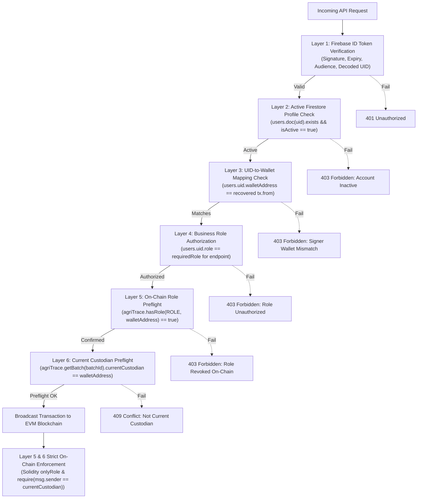
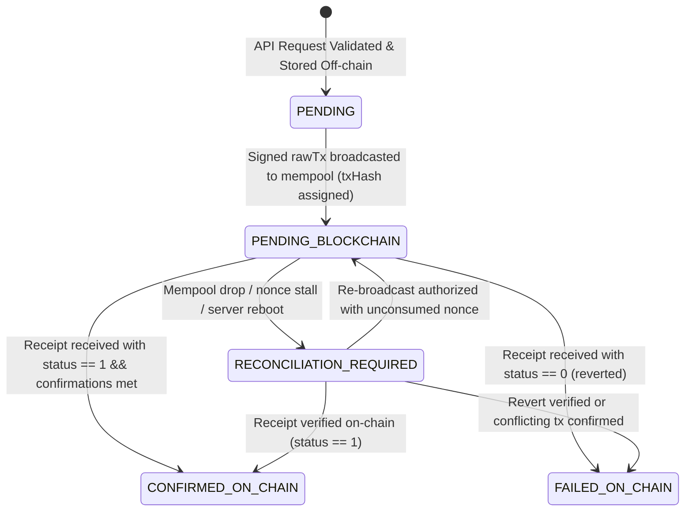
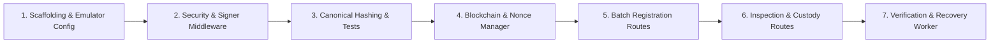

# AgriTrace: Backend Architecture & REST API Specification

> **Document Version**: 1.4.0  
> **Status**: Approved Specification (Finalized Nonce Reservation Architecture & Verified Hardhat Test Suite)  
> **Target Framework**: Node.js (v20+ LTS) + Express.js  
> **Cloud & Persistence**: Firebase Admin SDK (Auth, Cloud Firestore, Cloud Storage, Emulator Suite)  
> **Web3 Integration**: ethers.js (v6.17.0) + AgriTrace Solidity Smart Contract  
> **Client Platform**: Flutter Mobile Application (QR Consumer / Supply Chain Roles)

---

## 1. Executive Summary & System Architecture

AgriTrace implements a **hybrid dual-layer architecture** bridging decentralized cryptographic trust with scalable, high-performance cloud services:

1. **On-Chain Settlement Layer ([`AgriTrace.sol`](file:///c:/Users/pheon/OneDrive/Desktop/AgriTrace/blockchain/contracts/AgriTrace.sol))**:
   - Maintains the canonical state machine (`CREATED`, `QUALITY_VERIFIED`, `QUALITY_REJECTED`, `IN_TRANSIT`, `AT_WAREHOUSE`, `AT_RETAILER`, `DELIVERED`).
   - Validates role-based access control (`FARMER_ROLE`, `INSPECTOR_ROLE`, `TRANSPORTER_ROLE`, `WAREHOUSE_ROLE`, `RETAILER_ROLE`).
   - Anchors 32-byte cryptographic hashes (`batchId`, `metadataHash`, `reportHash`, `handoverHash`, `milestoneHash`, `acceptanceHash`).
   - Strictly validates physical custody and participant identity via EVM execution (`msg.sender == currentCustodian`, `newCustodian != msg.sender`).

2. **Off-Chain Cloud Layer (Node.js REST API + Firebase)**:
   - **Firebase Authentication**: Validates user identity and issues cryptographically signed JWT ID tokens.
   - **Cloud Firestore**: Stores rich crop metadata, geolocation coordinates, telemetry logs, subcollection audit trails, atomic nonce reservations, and indexed batch listings.
   - **Cloud Storage**: Retains binary media assets (farm photos, quality audit PDFs, bills of lading).
   - **Express REST API**: Serves as the orchestration engine, handling validation, canonical serialization, hash generation, signed transaction verification, broadcast relaying, and QR code resolution.

```mermaid
flowchart TD
    subgraph Clients["Clients (Individual Key Custody)"]
        MobileFarmer["Farmer Device (Farmer Wallet A)"]
        MobileInspector["Inspector Device (Inspector Wallet B)"]
        MobileLogistics["Transporter Device (Transporter Wallet C)"]
        MobileWarehouse["Warehouse Device (Warehouse Wallet D)"]
        MobileRetailer["Retailer Device (Retailer Wallet E)"]
        ConsumerApp["Consumer Mobile / QR Scanner"]
    end

    subgraph FirebaseServices["Firebase Platform (Emulated / Cloud)"]
        FirebaseAuth["Firebase Authentication (JWT ID Tokens)"]
        Firestore["Cloud Firestore (Metadata, Mappings, Nonce Reservations, Txs)"]
        CloudStorage["Firebase Cloud Storage (Photos, Lab Reports, BOLs)"]
    end

    subgraph BackendAPI["Node.js / Express Backend (/api/v1)"]
        AuthMW["Auth Middleware (verifyIdToken + Profile Lookup)"]
        NonceManager["Atomic Nonce Reservation Manager (Firestore Mutex)"]
        SignerVerify["Pre-Broadcast Signer, Nonce & Payload Validator"]
        RoleMW["Role Authorization (Firestore + On-Chain Preflight)"]
        HashingEngine["Canonical Serialization & keccak256 Engine"]
        TxBroadcaster["Transaction Broadcaster & Receipt Monitor"]
        Reconciliation["Consistency & Nonce Recovery Worker"]
    end

    subgraph Blockchain["EVM Blockchain (Hardhat Node / Testnet)"]
        Contract["AgriTrace.sol (AccessControl + State Machine)"]
    end

    Clients -->|1. Authenticate| FirebaseAuth
    Clients -->|2. Request Unsigned Tx Parameters & Reserve Nonce| NonceManager
    NonceManager -->|Atomic Reservation & Lock| Firestore
    NonceManager -->>Clients| Return Unsigned Payload + reservationId
    Clients -->|3. Sign Locally & Submit signedTxHex + reservationId| AuthMW
    ConsumerApp -->|Public Verify Request (No Auth)| BackendAPI

    AuthMW -->|Verify UID & Active Status| Firestore
    SignerVerify -->|Validate signedTxHex Nonce against reservationId| Firestore
    SignerVerify -->|Assert Recovered Address == users.uid.walletAddress| Firestore
    BackendAPI -->|Validate Anchor Hashes| HashingEngine
    BackendAPI -->|Record Document in PENDING State| Firestore
    TxBroadcaster -->|Broadcast Raw Tx: msg.sender is Participant| Contract
    Contract -->|Emit Auditable Events| TxBroadcaster
    Contract -.->|Zero-Gas Direct eth_call View Read| BackendAPI
    Reconciliation -.->|Audit Nonces & Reconcile Pending Txs| Firestore
```

---

## 2. Proposed Backend Folder Structure

The backend structure enforces strict separation of concerns, testability, and non-custodial transaction dispatching under `backend/`:

```text
backend/
├── .env.example                     # Environment template (PORT, RPC_URL, EMULATOR flags, etc.)
├── .env.test                        # Test environment configurations for automated test suites
├── .gitignore                       # Excludes node_modules, .env*, credentials, and coverage
├── package.json                     # Dependencies: express, firebase-admin, ethers@6.17.0, cors, helmet, joi
├── README.md                        # Setup and developer documentation
└── src/
    ├── app.js                       # Express app configuration, CORS, parsers, and route registration
    ├── server.js                    # Server startup, graceful shutdown handlers, and port listener
    ├── config/
    │   ├── env.js                   # Validates and exposes typed environment variables (Joi schema)
    │   ├── firebase.js              # Initializes Firebase Admin SDK (supporting Emulator Suite & Cloud)
    │   ├── blockchain.js            # Initializes ethers.js JsonRpcProvider and AgriTrace Contract factory
    │   └── constants.js             # Role constants, BatchStatus enums, event names, and status codes
    ├── middleware/
    │   ├── auth.middleware.js       # Firebase ID token validation and user profile binding
    │   ├── role.middleware.js       # Multi-layer role authorization (Firestore & on-chain preflight)
    │   ├── signer.middleware.js     # Validates signedTxHex: sender, contract, chainId, nonce, args, reservation
    │   ├── validate.middleware.js   # Request schema validation (Joi schemas)
    │   └── error.middleware.js      # Global centralized error handling and EVM revert translation
    ├── routes/
    │   ├── index.js                 # API v1 central router aggregating all domain sub-routers
    │   ├── auth.routes.js           # User registration, profile fetching, and wallet association
    │   ├── batch.routes.js          # Farmer batch creation, metadata retrieval, and batch listings
    │   ├── inspection.routes.js     # Quality audit recording and inspection verification
    │   ├── transfer.routes.js       # Custody handovers (direct, initiate, accept, cancel)
    │   ├── milestone.routes.js      # Operational checkpoints and telemetry logging
    │   ├── delivery.routes.js       # Final retail consumer delivery confirmation
    │   └── verify.routes.js         # Public consumer QR verification and provenance timeline
    ├── controllers/
    │   ├── auth.controller.js       # User profiles, role checks, and wallet linkage
    │   ├── batch.controller.js      # Batch creation, unsigned tx preparation, and batch queries
    │   ├── inspection.controller.js # Inspection audits and pass/fail workflows
    │   ├── transfer.controller.js   # Custody transfer preparation and submission
    │   ├── milestone.controller.js  # Operational milestone logging
    │   ├── delivery.controller.js   # Retail delivery finalization
    │   └── verify.controller.js     # Public verification and QR code payloads
    ├── services/
    │   ├── firestore.service.js     # Firestore document CRUD, atomic batch commits, and queries
    │   ├── nonce.service.js         # Atomic Firestore nonce reservation, allocation, and tracking
    │   ├── blockchain.service.js    # Unsigned tx preparation, raw tx broadcast, and receipt polling
    │   ├── hashing.service.js       # Deterministic canonical serialization and keccak256 computation
    │   ├── storage.service.js       # Firebase Storage file upload and signed URL generation
    │   ├── qr.service.js            # QR code generation (PNG data URI / SVG)
    │   └── reconciliation.service.js# Recovery worker for stalled, dropped, or replaced transactions
    ├── contracts/
    │   └── AgriTrace.json           # ABI and deployment metadata for AgriTrace.sol
    └── utils/
        ├── canonicalize.js          # Deterministic key sorting, quantity formatting, and normalization utility
        ├── logger.js                # Structured logging (Winston)
        ├── response.js              # Standardized API response envelope { success, data, error }
        └── asyncHandler.js          # Async wrapper to forward controller exceptions to middleware
```

---

## 3. Individual Participant Wallet Signing & Nonce Reservation Architecture

### 3.1 Core Principles
1. **Unique Participant Identity**: Every supply chain participant (Farmer, Quality Inspector, Transporter, Warehouse, Retailer) possesses a **unique Ethereum wallet address**.
2. **Zero Plaintext Private Keys on Backend/Firestore**: The backend and Firestore **never** receive, generate, or store participant private keys. Private keys remain exclusively on client devices (e.g., in Flutter using `flutter_secure_storage` or hardware keystore) or, during automated local testing, in isolated test execution runners.
3. **Preservation of `msg.sender`**: Because [`AgriTrace.sol`](file:///c:/Users/pheon/OneDrive/Desktop/AgriTrace/blockchain/contracts/AgriTrace.sol) evaluates `msg.sender` for access control, state transitions, and anti-self-transfer constraints (`require(newCustodian != msg.sender)`), transactions are signed **directly by the participant's key**.
4. **UID-to-Wallet Binding**: Firestore maps `users/{uid}.walletAddress`. The backend verifies that the signer address recovered from the raw transaction matches the authenticated user's linked wallet before broadcasting.
5. **No Backend Signer**: The backend does **not** maintain a server-side private key signer for participant transactions. It acts strictly as an un-trusted relay, validator, and event listener.

### 3.2 Pre-Broadcast Signed Transaction Validation Rules

Before broadcasting any raw signed transaction (`signedTxHex`) via `provider.broadcastTransaction()`, the backend executes the following comprehensive pre-flight validations:

1. **Recovered Signer Address (`tx.from`)**:
   - The transaction is parsed via `ethers.Transaction.from(signedTxHex)`.
   - The recovered sender `tx.from` is extracted.
2. **Authenticated Firebase UID-to-Wallet Mapping**:
   - The recovered address is checked against the authenticated user:
     $$\text{ethers.getAddress}(tx.from) === \text{ethers.getAddress}(req.user.walletAddress)$$
   - If mismatched, the request is rejected immediately with `403 Forbidden: "Signer address does not match registered wallet"`.
3. **Target Contract Address Verification (`tx.to`)**:
   - Asserts:
     $$\text{ethers.getAddress}(tx.to) === \text{ethers.getAddress}(config.AGRITRACE_CONTRACT_ADDRESS)$$
   - Rejects with `422 Unprocessable Entity: "Transaction recipient does not match AgriTrace contract address"`.
4. **Chain ID Verification (`tx.chainId`)**:
   - Asserts:
     $$\text{BigInt}(tx.chainId) === \text{BigInt}(config.CHAIN_ID)$$
   - Prevents cross-chain replay attacks or misconfigured testnet submissions.
5. **Zero Transaction Value Enforcement (`tx.value`)**:
   - Asserts:
     $$tx.value === 0n$$
   - Since no AgriTrace smart contract function is `payable`, any non-zero native ether transfer is rejected with `422 Unprocessable Entity: "Payable transactions are prohibited"`.
6. **Transaction Nonce Validation Against Reservation**:
   - Validates that `tx.nonce === reservation.nonce` where `reservation` is the authenticated, active reservation record identified by `req.body.reservationId`.
   - Verifies that $latestMinedNonce \le tx.nonce$.
   - Any transaction with $tx.nonce < latestMinedNonce$ is rejected with `409 Conflict: "Nonce expired on chain"`.
7. **Decoded Function Selector & Arguments Consistency**:
   - Decodes call data: `decoded = contract.interface.parseTransaction({ data: tx.data, value: tx.value })`.
   - Asserts `decoded.name === expectedFunctionName` (e.g. `'createBatch'`).
   - Asserts decoded arguments strictly match the authenticated request payload:
     - For `createBatch(bytes32 batchId, bytes32 metadataHash)`:
       - `decoded.args[0] === expectedBatchId` (re-derived from `req.body.humanBatchId`).
       - `decoded.args[1] === expectedMetadataHash` (re-derived from canonicalizing `req.body.canonicalMetadata`).
     - For `verifyQuality(bytes32 batchId, bool approved, bytes32 reportHash)`:
       - `decoded.args[0] === expectedBatchId`.
       - `decoded.args[1] === req.body.approved`.
       - `decoded.args[2] === expectedReportHash`.
     - For custody transfers and milestones:
       - `decoded.args` match the validated recipient address, target status, and documentation hashes.
8. **Idempotency Key & Payload Consistency**:
   - Validates that the provided `idempotencyKey` has not been used with a differing payload. Rejects duplicate submissions with conflicting payloads with `409 Conflict`.

---

### 3.3 Atomic Nonce Reservation & Concurrent Execution Architecture

To guarantee that concurrent transaction preparation requests do not generate nonce collisions across horizontally scaled backend instances, and to reconcile the relationship between on-chain mempool state and in-flight client signing, AgriTrace implements an **Atomic Firestore Nonce Reservation System**:

#### 1. The Concurrency Challenge
- `provider.getTransactionCount(wallet, 'pending')` returns the next unallocated nonce in the node's mempool.
- If User A submits two rapid `/prepare` calls before the first transaction is signed and broadcast:
  - Both calls would receive the same pending nonce (e.g., 5), causing the second broadcast to fail with `NONCE_EXPIRED` or replacement rejection.
  - Conversely, if the second call is assigned nonce 6, naive node validation (`tx.nonce < pendingNonce` or `tx.nonce === pendingNonce`) would reject nonce 6 because at the node's mempool level, nonce 5 is not yet mined!

#### 2. Atomic Firestore Nonce Reservation Protocol
Each reservation is allocated inside an atomic Firestore transaction (`firestore.runTransaction`):
- Reads `walletNonceTrackers/{walletAddress}`.
- Reads `rpcPendingNonce = await provider.getTransactionCount(walletAddress, 'pending')`.
- Reads `latestMinedNonce = await provider.getTransactionCount(walletAddress, 'latest')`.
- **For New Transactions (`type: "NEW_TRANSACTION"`)**:
  $$\text{assignedNonce} = \max(\text{rpcPendingNonce}, \text{tracker.highestReservedNonce} + 1)$$
  *(If `tracker.highestReservedNonce` is absent or $< rpcPendingNonce$, $\text{assignedNonce} = rpcPendingNonce$).*
- Generates a unique `reservationId` (UUIDv4).
- Writes `nonceReservations/{reservationId}`:
  ```json
  {
    "reservationId": "f47ac10b-58cc-4372-a567-0e02b2c3d479",
    "uid": "usr_farm_8832a7b1",
    "walletAddress": "0x70997970C51812dc3A010C7d01b50e0d17dc79C8",
    "nonce": 6,
    "type": "NEW_TRANSACTION",
    "targetFunction": "createBatch",
    "idempotencyKey": "idem_batch_991823",
    "status": "RESERVED",
    "createdAt": "2026-11-05T12:00:00.000Z",
    "expiresAt": "2026-11-05T12:05:00.000Z",
    "broadcastAt": null,
    "txHash": null,
    "replacementForTxHash": null
  }
  ```
- Updates `walletNonceTrackers/{walletAddress}`:
  ```json
  {
    "highestReservedNonce": 6,
    "activeReservations": ["f47ac10b-58cc-4372-a567-0e02b2c3d479"],
    "updatedAt": "2026-11-05T12:00:00.000Z"
  }
  ```
- Returns `{ reservationId, to, data, nonce: assignedNonce, gasLimit, maxFeePerGas, chainId }` to the client.

#### 3. Handling Replacement Transactions
- Replacement transactions (speeding up or cancelling a pending transaction) do **not** increment the nonce.
- They must reference the `originalTxHash` or `originalReservationId`.
- The assigned nonce is set to the original transaction's nonce:
  $$\text{assignedNonce} = \text{originalReservation.nonce}$$
- Validates that $latestMinedNonce \le assignedNonce < rpcPendingNonce$.
- Allocates a replacement reservation record with `type: "REPLACEMENT_TRANSACTION"` and `replacementForTxHash: originalTxHash`.

#### 4. Pre-Broadcast Validation Against Reservation
When the client submits `{ signedTxHex, reservationId, idempotencyKey }`:
- Reads `nonceReservations/{reservationId}` within a Firestore atomic transaction:
  - Asserts document exists and `reservation.uid === req.user.uid`.
  - Asserts `reservation.walletAddress.toLowerCase() === req.user.walletAddress.toLowerCase()`.
  - Asserts `reservation.idempotencyKey === req.body.idempotencyKey`.
  - Asserts `reservation.status === "RESERVED"`.
  - **Duplicate Submission Guard**: If `status === "COMMITTED"`, the request is rejected with `409 Conflict: "Reservation already committed"`.
- Parses `signedTxHex` and asserts:
  $$\text{tx.nonce} === \text{reservation.nonce}$$
  *(Validation succeeds because `tx.nonce` is matched against its legitimate atomic reservation, resolving any conflict with node-level pending nonces!)*
- Updates `reservation.status = "COMMITTED"`, `reservation.txHash = txResponse.hash`, and `reservation.broadcastAt = now`.

#### 5. Handling Expired Reservations & Device Safety
- **Why Nonces Are Never Released Automatically**:
  If an unsubmitted reservation expires (e.g. after 5 minutes) and the backend were to automatically decrement `highestReservedNonce` or re-assign that nonce to another transaction, a severe race condition occurs: a mobile device might have signed the payload offline and is attempting to broadcast it over high latency. Assigning that nonce to a different transaction causes a collision.
- **Safe Expiration Rules**:
  - Expired unsubmitted reservations transition to `EXPIRED_LOCKED`.
  - The `highestReservedNonce` counter **never decrements backwards**. Subsequent `/prepare` calls always allocate $\ge \text{highestReservedNonce} + 1$, maintaining monotonic progress.
  - If the client subsequently submits the signed transaction with the expired reservation, the backend verifies whether $latestMinedNonce \le tx.nonce$. If the nonce is still unconsumed on-chain, the backend commits and broadcasts it, gracefully supporting intermittent rural mobile network connectivity.
  - Only if the client explicitly issues a cancellation confirmation (`/reservations/:id/release`) AND the RPC provider verifies `latestMinedNonce < nonce` with no signed transaction ever broadcasted can a reservation be marked `CANCELLED`.

#### 6. Multi-Instance Concurrency
- All reservation operations execute inside Firestore atomic transactions (`firestore.runTransaction`), which enforce optimistic locking and serializability across distributed Express server instances.

#### 7. Zero Server Private Key Storage
- The backend maintains zero private keys, stores zero keys, and never signs transactions.

---

### 3.4 Transaction Broadcasting, Mempool Lifecycle, and Receipt Handling

The backend strictly distinguishes between the five discrete stages of transaction processing:

1. **Transaction Successfully Broadcast**:
   - Calling `const txResponse = await provider.broadcastTransaction(signedTxHex)` returns a `TransactionResponse` object containing `hash`, `from`, `to`, `nonce`, etc.
   - **Crucial Rule**: `broadcastTransaction()` returns a transaction response, **not** an immediately mined receipt.
   - At this instant, the transaction has been admitted into the RPC node's mempool, but **has not been included in a block**.
2. **Transaction Pending in Mempool**:
   - Firestore is updated with:
     ```json
     {
       "syncStatus": "PENDING_BLOCKCHAIN",
       "blockchainSync": {
         "txHash": txResponse.hash,
         "submittedAt": "2026-11-01T10:01:45.000Z",
         "confirmations": 0
       }
     }
     ```
   - The API immediately returns HTTP `202 Accepted` to the mobile client with `{ humanBatchId, txHash, reservationId, status: "PENDING_BLOCKCHAIN" }`.
   - **Firestore must NOT be marked `CONFIRMED_ON_CHAIN` merely because broadcasting succeeded.**
3. **Transaction Mined**:
   - The transaction is included in a block. A `TransactionReceipt` is produced with `receipt.blockNumber`, `receipt.gasUsed`, and `receipt.status`.
4. **Transaction Confirmed (Confirmation Policy)**:
   - **Local Hardhat Network**: Hardhat automines transactions instantly (`confirmations: 1`). The receipt is obtained immediately upon `txResponse.wait(1)` or polling `provider.getTransactionReceipt(txHash)`.
   - **Public Testnets / Production**: Requires $N \ge 2$ block confirmations (`txResponse.wait(config.CONFIRMATION_BLOCKS)`) to guard against shallow chain reorganizations.
   - Only when `receipt.status === 1` and the required confirmations are met does Firestore transition to:
     ```json
     {
       "syncStatus": "CONFIRMED_ON_CHAIN",
       "status": targetStatus,
       "blockchainSync": {
         "txHash": receipt.hash,
         "blockNumber": receipt.blockNumber,
         "gasUsed": receipt.gasUsed.toString(),
         "confirmedAt": "2026-11-01T10:02:15.000Z"
       }
     }
     ```
5. **Transaction Reverted**:
   - If `receipt.status === 0`, the transaction was included in a block but failed execution.
   - The backend simulates the transaction via `provider.call(txResponse, receipt.blockNumber)` to extract the exact revert string.
   - Firestore is updated to `syncStatus: "FAILED_ON_CHAIN"` with `revertReason`. Uncommitted off-chain state is safely rolled back.

### 3.5 Corrected Sequence Diagram

```mermaid
sequenceDiagram
    autonumber
    actor Participant as Supply Chain Actor (Mobile Client)
    participant API as Express API (/api/v1)
    participant NonceService as Nonce Reservation Manager
    participant Validator as Signer & Payload Validator
    participant Firestore as Cloud Firestore
    participant Provider as Ethereum RPC Provider
    participant EVM as EVM Blockchain Node

    Note over Participant,API: Phase 1: Request Unsigned Tx Parameters & Reserve Nonce
    Participant->>API: POST /batches/prepare (Payload + Bearer Token)
    API->>NonceService: reserveNonce(walletAddress, uid, idempotencyKey)
    NonceService->>Firestore: Atomic Transaction: assign max(pendingNonce, highestReserved + 1)
    Firestore-->>NonceService: reservationId + assignedNonce
    NonceService-->>API: reservationId + assignedNonce
    API-->>Participant: 200 OK { to, data, nonce: assignedNonce, reservationId, gasLimit, maxFeePerGas, chainId }

    Note over Participant: Phase 2: Local Signing on Device
    Participant->>Participant: Wallet.signTransaction(txData) -> signedTxHex

    Note over Participant,API: Phase 3: Submit Signed Raw Transaction + reservationId
    Participant->>API: POST /batches (Metadata + signedTxHex + reservationId + idempotencyKey)
    API->>Validator: Validate ID Token, recovered tx.from, tx.to, tx.chainId, tx.value == 0, tx.nonce == reservation.nonce, decoded args
    Validator->>Firestore: Atomic Transaction: mark reservation COMMITTED
    Validator-->>API: Validation Passed

    API->>Firestore: Pre-write document (syncStatus: PENDING_BLOCKCHAIN, txHash)
    API->>Provider: provider.broadcastTransaction(signedTxHex)
    Provider-->>API: txResponse (Mempool Admission Confirmed, txHash)
    API-->>Participant: 202 Accepted { humanBatchId, txHash, reservationId, status: "PENDING_BLOCKCHAIN" }

    Note over API,EVM: Phase 4: Asynchronous Receipt Monitoring
    par Receipt Waiting
        API->>Provider: txResponse.wait(CONFIRMATIONS) / getTransactionReceipt(txHash)
        EVM-->>Provider: Block Mined with Transaction
        Provider-->>API: receipt (status == 1, blockNumber)
        API->>Firestore: Atomic Update (syncStatus: CONFIRMED_ON_CHAIN, blockNumber, status)
    and Client Polling / Webhook
        Participant->>API: GET /batches/BATCH-2026-TOMATO-001
        API-->>Participant: 200 OK (syncStatus: CONFIRMED_ON_CHAIN)
    end
```

---

## 4. Multi-Layer Role Authorization

AgriTrace implements **defense-in-depth authorization** across six distinct validation layers:



### 4.1 Check Enforcement Matrix

| Layer | Verification Target | Enforced In Middleware (Express) | Enforced In Smart Contract ([`AgriTrace.sol`](file:///c:/Users/pheon/OneDrive/Desktop/AgriTrace/blockchain/contracts/AgriTrace.sol)) | Failure Response / Revert Reason |
|---|---|:---:|:---:|---|
| **Layer 1** | Firebase ID Token validity & UID extraction | **Yes** (`auth.middleware.js`) | No | `401 Unauthorized: "Bearer token missing, invalid or expired"` |
| **Layer 2** | Active user profile in Firestore | **Yes** (`auth.middleware.js`) | No | `403 Forbidden: "User profile inactive or unlinked"` |
| **Layer 3** | UID mapped to recovered raw transaction signer | **Yes** (`signer.middleware.js`) | No | `403 Forbidden: "Signer address does not match registered wallet"` |
| **Layer 4** | Business role matches API route permission | **Yes** (`role.middleware.js`) | No | `403 Forbidden: "Insufficient application permissions"` |
| **Layer 5** | Wallet address holds required role on-chain | **Yes** (Preflight `eth_call`) | **Yes** ([`onlyRole`](file:///c:/Users/pheon/OneDrive/Desktop/AgriTrace/blockchain/contracts/AgriTrace.sol#L167)) | `AccessControlUnauthorizedAccount(address, bytes32)` |
| **Layer 6** | Wallet address is active batch custodian | **Yes** (Preflight `eth_call`) | **Yes** ([`require(msg.sender == custodian)`](file:///c:/Users/pheon/OneDrive/Desktop/AgriTrace/blockchain/contracts/AgriTrace.sol#L281)) | `"Caller is not current custodian"` |

---

## 5. Transaction State Machine & Consistency Strategy

### 5.1 The 5 Transaction States



| State | Description | In-Flight Handling |
|---|---|---|
| **`PENDING`** | Off-chain validation completed; pre-write stored in Firestore with unique `idempotencyKey`; awaiting raw transaction broadcast. | If network drops prior to broadcast, record remains in `PENDING` and can safely be retried using the same `idempotencyKey`. |
| **`PENDING_BLOCKCHAIN`** | Signed transaction broadcasted to EVM mempool; valid `txHash` assigned; monitoring for inclusion. | Actively polled using `provider.getTransactionReceipt(txHash)`. **Never auto-failed after 60 seconds.** |
| **`CONFIRMED_ON_CHAIN`** | Transaction mined in a confirmed block; receipt returns `status === 1` with required confirmations. | Final success state. Off-chain batch status atomically updated to match on-chain transition. |
| **`FAILED_ON_CHAIN`** | Transaction mined with receipt `status === 0` (EVM revert) or rejected at RPC admission. | Terminal failure. Revert string extracted; uncommitted state changes rolled back. |
| **`RECONCILIATION_REQUIRED`** | Ambiguous state: transaction missing from mempool, nonce gap detected, transaction replaced/sped up, or server restarted during broadcast. | Background worker investigates node status, queries sender nonce, and resolves state. |

### 5.2 Corrected Reconciliation and Nonce Recovery Protocol

Distributed blockchain systems face dropped transactions, network partitions, or client gas-bumping. The reconciliation worker ([`reconciliation.service.js`](file:///c:/Users/pheon/OneDrive/Desktop/AgriTrace/docs/backend-architecture.md#L41)) implements this rigorous protocol:

1. **Check Original Receipt**:
   - Calls `provider.getTransactionReceipt(txHash)`.
   - If receipt exists:
     - If `receipt.status === 1`: Transition to `CONFIRMED_ON_CHAIN`, committing block number and timestamp.
     - If `receipt.status === 0`: Transition to `FAILED_ON_CHAIN`, recording revert string.
2. **Check Mempool Presence**:
   - If receipt is `null`, call `provider.getTransaction(txHash)`.
   - If the transaction is still present in the node mempool:
     - The transaction is still pending. Keep status as `PENDING_BLOCKCHAIN`.
     - Continue monitoring. **Do not mark as failed.**
3. **Investigate Sender's Confirmed Transaction Count (Nonce Investigation)**:
   - If both `getTransactionReceipt(txHash)` and `getTransaction(txHash)` return `null`:
   - Query `currentMinedNonce = await provider.getTransactionCount(senderAddress, 'latest')`.
   - **Case A: `currentMinedNonce <= tx.nonce` (Nonce Unconsumed)**:
     - The nonce has **not** been used by any mined transaction. The transaction was dropped from the mempool (e.g. underpriced gas during network traffic surge).
     - Transition document to `RECONCILIATION_REQUIRED`.
     - **Safety Rule**: **Avoid blind rebroadcasting.** The worker must verify current network gas price before deciding whether to re-broadcast or prompt the client app to sign with a higher fee.
   - **Case B: `currentMinedNonce > tx.nonce` (Nonce Consumed)**:
     - The nonce was already consumed by another mined transaction (e.g. the participant sped up or replaced the transaction with a higher gas price, or executed an out-of-band transfer).
     - **Important Correction**: The worker does **not** assume the replacement transaction can be identified from ordinary contract event logs (as event logs may not be emitted if a non-contract or different function executed).
     - The worker inspects confirmed block transactions from the sender at that specific nonce (if an archival or trace node is available) or marks the record as `RECONCILIATION_REQUIRED` with diagnostic details for audit review.
4. **Application Restart Recovery**:
   - Upon server startup, [`reconciliation.service.js`](file:///c:/Users/pheon/OneDrive/Desktop/AgriTrace/docs/backend-architecture.md#L41) executes a boot scan querying all Firestore documents in `PENDING_BLOCKCHAIN` or `RECONCILIATION_REQUIRED`.
   - It queries receipts for each in-flight transaction, ensuring any blocks mined while the API was restarting are cleanly synchronized to `CONFIRMED_ON_CHAIN`.
5. **Strict Evidence Rule**:
   - The backend **never** marks an unresolved transaction as successful or failed without definitive on-chain evidence (`receipt.status`).

---

## 6. Strict Metadata Canonicalization, Quantity Rules, & Verified Golden Vectors

To ensure that Node.js, Flutter (Dart), and Solidity/EVM always derive the exact same 32-byte cryptographic hash, the metadata specification enforces strict deterministic standards.

### 6.1 The 7 Anchored Fields Specification

Only the following seven fields are anchored into `metadataHash`. **Anchored fields are strictly immutable and must never be altered after batch creation:**

| # | Field Name | Type | Normalization & Format Rules | Example Value |
|:---:|---|---|---|---|
| **1** | `category` | `string` | Unicode NFC normalized; trimmed of leading/trailing whitespace. | `"Fresh Produce"` |
| **2** | `cropVariety` | `string` | Unicode NFC normalized; trimmed of leading/trailing whitespace. | `"Roma Tomato"` |
| **3** | `harvestDate` | `string` | Strict ISO 8601 UTC format: `YYYY-MM-DDTHH:mm:ssZ`. Exactly 2 digits for month/day/hour/min/sec; no milliseconds; literal `Z`. | `"2026-11-01T10:00:00Z"` |
| **4** | `humanBatchId` | `string` | Non-empty; trimmed; uppercase ASCII matching `BATCH-[A-Z0-9-]+`. | `"BATCH-2026-TOMATO-001"` |
| **5** | `origin` | `string` | Unicode NFC normalized; trimmed of leading/trailing whitespace. | `"Green Valley Farm"` |
| **6** | `quantity` | `number` | Strictly positive number ($> 0$). Defined by exact lexical validation and normalization rules in Section 6.2. | `1500` |
| **7** | `unit` | `string` | Lowercase; trimmed of leading/trailing whitespace (`kg`, `ton`, `quintal`). | `"kg"` |

### 6.2 Exact Quantity Canonicalization Rules

To avoid silent precision loss, rounding discrepancies, or scientific notation bugs across JavaScript V8 (Node.js) and Dart (Flutter), `quantity` undergoes **strict lexical pre-validation on the raw input representation before any numeric conversion**:

1. **Input Lexical Validation**:
   - The raw input is inspected prior to numeric coercion:
     `const rawStr = typeof rawQty === 'string' ? rawQty.trim() : String(rawQty).trim();`
   - **Scientific Notation Strictly Prohibited**: Any value matching `/[eE]/` is immediately rejected with HTTP 422.
   - **Pattern Enforcement**: Must strictly match `/^(0|[1-9]\d*)(\.\d+)?$/`. Leading zeros (e.g. `001500`), negative signs (`-10`), and non-numeric characters are rejected.
2. **Maximum Decimal Precision**:
   - The fractional part is evaluated:
     `const [intPart, fracPart] = rawStr.split('.');`
   - If `fracPart && fracPart.length > 3`: **REJECT with HTTP 422.**
   - **Strict Rule**: The system **never rounds** values with $> 3$ decimal places. Silent rounding is forbidden.
3. **Range & Positivity Enforcement**:
   - Parsed numeric value must satisfy $0.001 \le quantity \le 1,000,000,000$ ($10^9$, 1 billion units).
   - Zero (`0` or `0.000`) and values $> 10^9$ are rejected with HTTP 422.
4. **Trailing Zeros Normalization**:
   - If `fracPart` exists:
     `const cleanFrac = fracPart.replace(/0+$/, '');`
   - If `cleanFrac.length === 0`: normalized representation is integer `intPart` (e.g. `"1500.0"` $\rightarrow$ `1500`).
   - If `cleanFrac.length > 0`: normalized representation is `${intPart}.${cleanFrac}` (e.g. `"12.50"` $\rightarrow$ `12.5`).
5. **Cross-Platform Implementation**:
   - **Node.js**:
     ```javascript
     function canonicalizeQuantity(raw) {
       const str = (typeof raw === 'string' ? raw : String(raw)).trim();
       if (/[eE]/.test(str)) throw new Error("Scientific notation prohibited");
       if (!/^(0|[1-9]\d*)(\.\d+)?$/.test(str)) throw new Error("Invalid quantity format");
       
       const [intPart, fracPart] = str.split('.');
       if (fracPart && fracPart.length > 3) throw new Error("Exceeds maximum 3 decimal places");
       
       const num = Number(str);
       if (num <= 0 || num > 1e9) throw new Error("Quantity out of bounds (0.001 - 1000000000)");
       
       const cleanFrac = fracPart ? fracPart.replace(/0+$/, '') : '';
       const normStr = cleanFrac.length > 0 ? `${intPart}.${cleanFrac}` : intPart;
       return Number(normStr);
     }
     ```
   - **Flutter (Dart)**:
     ```dart
     num canonicalizeQuantity(dynamic raw) {
       final str = raw.toString().trim();
       if (RegExp(r'[eE]').hasMatch(str)) throw FormatException("Scientific notation prohibited");
       if (!RegExp(r'^(0|[1-9]\d*)(\.\d+)?$').hasMatch(str)) throw FormatException("Invalid quantity format");
       
       final parts = str.split('.');
       final intPart = parts[0];
       final fracPart = parts.length > 1 ? parts[1] : null;
       if (fracPart != null && fracPart.length > 3) throw FormatException("Exceeds maximum 3 decimal places");
       
       final numVal = num.parse(str);
       if (numVal <= 0 || numVal > 1000000000) throw RangeError("Quantity out of bounds (0.001 - 1000000000)");
       
       final cleanFrac = fracPart != null ? fracPart.replaceAll(RegExp(r'0+$'), '') : '';
       final normStr = cleanFrac.isNotEmpty ? '$intPart.$cleanFrac' : intPart;
       return num.parse(normStr);
     }
     ```

---

## 6.3 Verified Golden Vectors & Exact Mathematical Derivation

The Golden Vectors were verified using the project's actual installed dependency ([`blockchain/node_modules/ethers`](file:///c:/Users/pheon/OneDrive/Desktop/AgriTrace/blockchain/node_modules/ethers) version **6.17.0**):

### 1. Reproducible Verification Procedure
Execute from the project workspace root:
```bash
node -e "
  const { ethers } = require('./blockchain/node_modules/ethers');
  const humanBatchId = 'BATCH-2026-TOMATO-001';
  const humanBatchIdBytes = ethers.toUtf8Bytes(humanBatchId);
  const batchId = ethers.keccak256(humanBatchIdBytes);

  const payload = {
    category: 'Fresh Produce',
    cropVariety: 'Roma Tomato',
    harvestDate: '2026-11-01T10:00:00Z',
    humanBatchId: 'BATCH-2026-TOMATO-001',
    origin: 'Green Valley Farm',
    quantity: 1500,
    unit: 'kg'
  };
  const canonicalJson = JSON.stringify(payload);
  const canonicalBytes = ethers.toUtf8Bytes(canonicalJson);
  const metadataHash = ethers.keccak256(canonicalBytes);

  console.log('ethers.version:', require('./blockchain/node_modules/ethers/package.json').version);
  console.log('humanBatchId:', humanBatchId);
  console.log('humanBatchId bytes:', humanBatchIdBytes.length);
  console.log('batchId:', batchId);
  console.log('canonicalJson:', canonicalJson);
  console.log('canonicalJson bytes:', canonicalBytes.length);
  console.log('metadataHash:', metadataHash);
"
```

### 2. Verified Execution Results
- **Ethers Version**: `6.17.0`
- **Human-Readable Batch ID**: `"BATCH-2026-TOMATO-001"`
- **Human-Readable Batch ID UTF-8 Byte Length**: **21** bytes
  - Byte sequence: `42 41 54 43 48 2d 32 30 32 36 2d 54 4f 4d 41 54 4f 2d 30 30 31`
- **Derived `batchId` (`keccak256`)**:
  ```text
  0x7078459f06a313998aff5f7192ae0fa5e58cf9823f4422a8073561b04462125e
  ```
- **Canonical JSON String**:
  ```json
  {"category":"Fresh Produce","cropVariety":"Roma Tomato","harvestDate":"2026-11-01T10:00:00Z","humanBatchId":"BATCH-2026-TOMATO-001","origin":"Green Valley Farm","quantity":1500,"unit":"kg"}
  ```
- **Canonical JSON UTF-8 Byte Length**: **189** bytes
- **Derived `metadataHash` (`keccak256`)**:
  ```text
  0xbec1c34ae775c4e85a9d48774328d093061dadc4422fffb483384410e74e658e
  ```

### 3. Comparison with Blockchain Test Fixture
In [`blockchain/test/AgriTrace.js`](file:///c:/Users/pheon/OneDrive/Desktop/AgriTrace/blockchain/test/AgriTrace.js#L15-L24):
```javascript
const sampleBatchId = ethers.keccak256(ethers.toUtf8Bytes("BATCH-2026-TOMATO-001"));
const sampleMetadataHash = ethers.keccak256(ethers.toUtf8Bytes(JSON.stringify({
  category: "Fresh Produce",
  cropVariety: "Roma Tomato",
  harvestDate: "2026-11-01T10:00:00Z",
  humanBatchId: "BATCH-2026-TOMATO-001",
  origin: "Green Valley Farm",
  quantity: 1500,
  unit: "kg"
})));
```
The values derived by the canonicalization pipeline match the values computed by Hardhat in `blockchain/test/AgriTrace.js` down to the exact bit:
$$\text{sampleBatchId} === \text{0x7078459f06a313998aff5f7192ae0fa5e58cf9823f4422a8073561b04462125e}$$
$$\text{sampleMetadataHash} === \text{0xbec1c34ae775c4e85a9d48774328d093061dadc4422fffb483384410e74e658e}$$

---

## 7. REST API Endpoint Specification

All endpoints are versioned under `/api/v1`.

### 7.1 Authentication & User Management

| Method | Endpoint | Access / Role | Purpose |
|---|---|---|---|
| `POST` | `/api/v1/auth/register` | Authenticated (Firebase User) | Registers user in Firestore; validates and associates Firebase UID with role and participant Ethereum wallet address. |
| `GET` | `/api/v1/auth/profile` | Authenticated (All Roles) | Returns calling user profile, role, organization details, and linked wallet address. |
| `PATCH` | `/api/v1/auth/profile` | Authenticated (All Roles) | Updates non-critical user profile data (display name, phone, bio). Wallet and role are protected from mutation. |
| `GET` | `/api/v1/users/roles/:walletAddress` | Authenticated | Queries on-chain contract roles and Firestore mapping for an Ethereum address. |

### 7.2 Farmer Batch Registration & Metadata Management

| Method | Endpoint | Access / Role | Purpose |
|---|---|---|---|
| `POST` | `/api/v1/batches/prepare` | `FARMER_ROLE` | Validates anchored metadata; computes `batchId` and canonical `metadataHash`; atomically allocates and reserves `nonce`; returns unsigned transaction parameters (`to`, `data`, `nonce`, `gasLimit`, `reservationId`) for client-side signing. |
| `POST` | `/api/v1/batches` | `FARMER_ROLE` | Accepts `signedTxHex` + `reservationId` + metadata payload. Validates signer and reservation parameters, records Firestore document with `syncStatus: PENDING_BLOCKCHAIN`, broadcasts transaction, and returns tracking status. |
| `GET` | `/api/v1/batches` | Authenticated (All Roles) | Lists batches with filtering (`status`, `cropVariety`, `currentCustodian`, `farmerAddress`, pagination). |
| `GET` | `/api/v1/batches/:humanBatchId` | Authenticated (All Roles) | Retrieves comprehensive batch details combining Firestore metadata and live on-chain status. |
| `PATCH` | `/api/v1/batches/:humanBatchId/metadata` | Current Custodian | Appends non-anchored contextual notes, packaging details, or transport logs. **Rejects any attempt to modify anchored fields.** |
| `POST` | `/api/v1/batches/:humanBatchId/media` | Current Custodian | Uploads photos or PDF certificates to Cloud Storage and appends storage URLs. |

### 7.3 Quality Inspection

| Method | Endpoint | Access / Role | Purpose |
|---|---|---|---|
| `POST` | `/api/v1/batches/:humanBatchId/inspect/prepare` | `INSPECTOR_ROLE` | Validates audit parameters; computes `reportHash`; atomically reserves nonce; returns unsigned call data and `reservationId` for [`verifyQuality`](file:///c:/Users/pheon/OneDrive/Desktop/AgriTrace/blockchain/contracts/AgriTrace.sol#L192). |
| `POST` | `/api/v1/batches/:humanBatchId/inspect` | `INSPECTOR_ROLE` | Accepts `signedTxHex` + `reservationId` + inspection report; verifies inspector signer matches linked wallet and reservation; broadcasts on-chain transaction; records report subcollection. |
| `GET` | `/api/v1/batches/:humanBatchId/inspections` | Authenticated (All Roles) | Retrieves inspection reports and lab certificates for a batch. |

### 7.4 Custody Transfer Workflows

| Method | Endpoint | Access / Role | Purpose |
|---|---|---|---|
| `POST` | `/api/v1/batches/:humanBatchId/transfers/prepare` | Current Custodian | Validates recipient role and target status; computes `handoverHash`; atomically reserves nonce; returns unsigned transaction data and `reservationId` for direct or two-step transfer. |
| `POST` | `/api/v1/batches/:humanBatchId/transfers/direct` | Current Custodian | Submits signed transaction for single-step [`transferCustody`](file:///c:/Users/pheon/OneDrive/Desktop/AgriTrace/blockchain/contracts/AgriTrace.sol#L217). |
| `POST` | `/api/v1/batches/:humanBatchId/transfers/initiate` | Current Custodian | Submits signed transaction for two-step [`initiateCustodyTransfer`](file:///c:/Users/pheon/OneDrive/Desktop/AgriTrace/blockchain/contracts/AgriTrace.sol#L250). |
| `POST` | `/api/v1/batches/:humanBatchId/transfers/accept` | Designated Recipient | Submits signed transaction for [`acceptCustody`](file:///c:/Users/pheon/OneDrive/Desktop/AgriTrace/blockchain/contracts/AgriTrace.sol#L294); re-validates recipient role. |
| `POST` | `/api/v1/batches/:humanBatchId/transfers/cancel` | Current Custodian | Submits signed transaction for [`cancelCustodyTransfer`](file:///c:/Users/pheon/OneDrive/Desktop/AgriTrace/blockchain/contracts/AgriTrace.sol#L279). |
| `GET` | `/api/v1/batches/:humanBatchId/transfers` | Authenticated (All Roles) | Retrieves custody transfer logs, bills of lading, and participant addresses. |

### 7.5 Milestone Logging & Final Delivery

| Method | Endpoint | Access / Role | Purpose |
|---|---|---|---|
| `POST` | `/api/v1/batches/:humanBatchId/milestones/prepare` | Current Custodian | Atomically reserves nonce and encodes [`logMilestone`](file:///c:/Users/pheon/OneDrive/Desktop/AgriTrace/blockchain/contracts/AgriTrace.sol#L360) transaction data with `milestoneHash`. |
| `POST` | `/api/v1/batches/:humanBatchId/milestones` | Current Custodian | Submits signed transaction and records environmental telemetry (GPS, temperature) in Firestore. |
| `GET` | `/api/v1/batches/:humanBatchId/milestones` | Public / Authenticated | Retrieves logged operational milestones and environmental telemetry. |
| `POST` | `/api/v1/batches/:humanBatchId/deliver` | `RETAILER_ROLE` & Custodian | Submits signed transaction for [`completeDelivery`](file:///c:/Users/pheon/OneDrive/Desktop/AgriTrace/blockchain/contracts/AgriTrace.sol#L343) to mark batch as sold. |

### 7.6 Consumer Verification & History Retrieval

| Method | Endpoint | Access / Role | Purpose |
|---|---|---|---|
| `GET` | `/api/v1/verify/:humanBatchId` | **Public** (Unauthenticated) | Consumer QR scan verification. Concurrently queries Firestore metadata and on-chain contract state via zero-gas `eth_call`. Asserts `keccak256(canonicalJson) == metadataHash`. |
| `GET` | `/api/v1/batches/:humanBatchId/qr` | Public | Generates QR code image (PNG) or structured payload (`{ app: "agritrace", v: "1.0", batchId: humanBatchId }`). |
| `GET` | `/api/v1/batches/:humanBatchId/history` | Public / Authenticated | Aggregates all on-chain events merged with Firestore documents into a unified chronological audit trail. |

---

## 8. Firestore Database Structure

### 8.1 Collection: `users/{uid}`
```json
{
  "uid": "usr_farm_8832a7b1",
  "email": "farmer.ramesh@agritrace.org",
  "displayName": "Ramesh Kumar",
  "role": "FARMER",
  "walletAddress": "0x70997970C51812dc3A010C7d01b50e0d17dc79C8",
  "organization": {
    "name": "Sahyadri Farmer Producer Co.",
    "location": "Nashik, Maharashtra, India",
    "geoPoint": { "latitude": 20.0059, "longitude": 73.7898 }
  },
  "contactPhone": "+91-9876543210",
  "isActive": true,
  "createdAt": "2026-11-01T08:00:00.000Z",
  "updatedAt": "2026-11-01T08:00:00.000Z"
}
```

### 8.2 Collection: `batches/{humanBatchId}`
```json
{
  "humanBatchId": "BATCH-2026-TOMATO-001",
  "batchIdHex": "0x7078459f06a313998aff5f7192ae0fa5e58cf9823f4422a8073561b04462125e",
  "metadataHash": "0xbec1c34ae775c4e85a9d48774328d093061dadc4422fffb483384410e74e658e",
  "canonicalMetadata": {
    "category": "Fresh Produce",
    "cropVariety": "Roma Tomato",
    "harvestDate": "2026-11-01T10:00:00Z",
    "humanBatchId": "BATCH-2026-TOMATO-001",
    "origin": "Green Valley Farm",
    "quantity": 1500,
    "unit": "kg"
  },
  "additionalMetadata": {
    "productName": "Organic Roma Tomatoes",
    "farmingMethod": "Organic - NPOP Standards",
    "certifications": ["India Organic", "Jaivik Bharat"],
    "photos": [
      "https://storage.googleapis.com/.../field_harvest.jpg"
    ]
  },
  "farmer": {
    "uid": "usr_farm_8832a7b1",
    "name": "Ramesh Kumar",
    "walletAddress": "0x70997970C51812dc3A010C7d01b50e0d17dc79C8"
  },
  "currentCustodian": {
    "uid": "usr_farm_8832a7b1",
    "name": "Ramesh Kumar",
    "role": "FARMER",
    "walletAddress": "0x70997970C51812dc3A010C7d01b50e0d17dc79C8"
  },
  "status": 0,
  "statusLabel": "CREATED",
  "syncStatus": "CONFIRMED_ON_CHAIN",
  "blockchainSync": {
    "txHash": "0x4b7891fa1a2c3d...",
    "blockNumber": 1042318,
    "onChainTimestamp": 1793527200,
    "confirmedAt": "2026-11-01T10:02:15.000Z"
  },
  "activePendingTransfer": null,
  "createdAt": "2026-11-01T10:00:00.000Z",
  "updatedAt": "2026-11-01T10:02:15.000Z"
}
```

### 8.3 Subcollections Under `batches/{humanBatchId}`
- **`inspections/{inspectionId}`**: Stores `inspectorAddress`, `approved` (bool), `reportHash`, `parameters`, `reportDocumentUrl`, `txHash`, and `inspectedAt`.
- **`transfers/{transferId}`**: Stores `type` (`DIRECT` / `TWO_STEP`), `previousCustodianAddress`, `newCustodianAddress`, `targetStatus`, `handoverHash`, `acceptanceHash`, `status` (`INITIATED` / `ACCEPTED` / `CANCELLED`), `initiateTxHash`, `acceptTxHash`.
- **`milestones/{milestoneId}`**: Stores `milestoneIndex`, `actorAddress`, `action`, `milestoneHash`, `telemetry`, `txHash`, and `timestamp`.

### 8.4 Collection: `nonceReservations/{reservationId}`
Stores atomic nonce reservations for concurrent transaction preparation:
```json
{
  "reservationId": "f47ac10b-58cc-4372-a567-0e02b2c3d479",
  "uid": "usr_farm_8832a7b1",
  "walletAddress": "0x70997970C51812dc3A010C7d01b50e0d17dc79C8",
  "nonce": 6,
  "type": "NEW_TRANSACTION",
  "targetFunction": "createBatch",
  "idempotencyKey": "idem_batch_991823",
  "status": "RESERVED",
  "createdAt": "2026-11-05T12:00:00.000Z",
  "expiresAt": "2026-11-05T12:05:00.000Z",
  "broadcastAt": null,
  "txHash": null,
  "replacementForTxHash": null
}
```

### 8.5 Collection: `walletNonceTrackers/{walletAddress}`
Tracks the state of highest reserved nonces per wallet across all backend instances:
```json
{
  "walletAddress": "0x70997970C51812dc3A010C7d01b50e0d17dc79C8",
  "highestReservedNonce": 6,
  "activeReservations": ["f47ac10b-58cc-4372-a567-0e02b2c3d479"],
  "updatedAt": "2026-11-05T12:00:00.000Z"
}
```

### 8.6 Collection: `blockchainTransactions/{txHash}`
Tracks transactions with fields: `txHash`, `humanBatchId`, `batchIdHex`, `functionName`, `fromAddress`, `toContract`, `nonce`, `status` (`PENDING`, `PENDING_BLOCKCHAIN`, `CONFIRMED_ON_CHAIN`, `FAILED_ON_CHAIN`, `RECONCILIATION_REQUIRED`), `idempotencyKey`, `revertReason`, `submittedAt`, `minedAt`.

---

## 9. Firebase & Blockchain Development Environment

```text
┌─────────────────────────────────────────────────────────────────────────────┐
│                            DEVELOPMENT WORKFLOW                             │
├──────────────────────────────────────┬──────────────────────────────────────┤
│ Firebase Emulator Suite              │ Local Hardhat EVM Node               │
│ - Auth Emulator (localhost:9099)     │ - JSON-RPC (http://127.0.0.1:8545)   │
│ - Firestore Emulator (localhost:8080)│ - Chain ID: 31337                    │
│ - Storage Emulator (localhost:9199)  │ - 20 Funded Test Accounts (10k ETH)  │
│ - Zero cloud billing & instant resets│ - Instant mining & block simulation  │
└──────────────────────────────────────┴──────────────────────────────────────┘
```

### 9.1 Firebase Emulator Suite Configuration
- In development and test modes (`NODE_ENV=development` / `NODE_ENV=test`), the backend connects exclusively to the local Firebase Emulator Suite:
  ```bash
  export FIREBASE_AUTH_EMULATOR_HOST="localhost:9099"
  export FIRESTORE_EMULATOR_HOST="localhost:8080"
  export FIREBASE_STORAGE_EMULATOR_HOST="localhost:9199"
  ```
- No real credentials, network billing, or cloud project quotas are consumed.

### 9.2 Local Hardhat Network
- Runs via `npx hardhat node` on `http://127.0.0.1:8545`.
- The deployed contract address is loaded via environment variable `AGRITRACE_CONTRACT_ADDRESS`.
- Test accounts provide pre-funded balances for rapid local test execution.

### 9.3 Environment Separation & Configuration
Three separate environments are configured:
1. `development`: Local Hardhat node + Firebase Emulator Suite.
2. `test`: Isolated in-memory tests with dedicated port bindings (`.env.test`).
3. `production`: Live Firebase Project + Ethereum Testnet (Sepolia/Polygon Amoy).

### 9.4 Safe Handling of Service Account Credentials & Keys
- **Credentials Policy**: Service account JSON files are **never** committed to version control. They are ignored via `.gitignore` (`*-service-account.json`, `credentials/`).
- In development with the emulator, mock credentials (`GCLOUD_PROJECT=agritrace-demo`) are used.
- In production, credentials are injected via `GOOGLE_APPLICATION_CREDENTIALS` path references external to the repository or passed as base64-encoded environment secrets.
- **Test Wallets Only**: Default Hardhat signers are used strictly within local tests. Real production private keys are strictly kept on user client devices.

---

## 10. Security Considerations & Threat Modeling

| Threat Vector | Mitigation Strategy |
|---|---|
| **ID Token Forgery** | Firebase Admin SDK cryptographically verifies tokens against Google's public x509 certs; checks audience and expiration. |
| **Signer Impersonation** | Backend verifies recovered signer address from `signedTxHex` matches `users/{uid}.walletAddress`. |
| **Nonce Collision & Race Conditions** | Atomic Firestore transactions manage per-wallet reservations and enforce sequential monotonic ordering across distributed instances. |
| **EVM Revert Injection** | Backend validates state machine preconditions and simulates execution via `contract.staticCall` before broadcast. |
| **Metadata Tampering in Firestore** | Recalculates `keccak256(canonicalJson)` on verification and compares against on-chain `metadataHash`. Mismatches trigger immediate tamper alerts. |
| **Private Key Exposure** | Server is 100% non-custodial: zero private keys stored on server or in Firestore. |
| **Replay Attacks** | Ethereum account nonces prevent replaying signed transactions; backend enforces unique `idempotencyKey` identifiers. |
| **API Denial of Service** | Express rate-limiting (`express-rate-limit`) on public verification and upload routes. |

---

## 11. Revised Implementation Sequence for Step 3B



1. **Phase 1: Project Scaffolding & Emulator Configuration**
   - Initialize `backend/package.json` with dependencies.
   - Configure environment schema validation ([`env.js`](file:///c:/Users/pheon/OneDrive/Desktop/AgriTrace/docs/backend-architecture.md#L30)).
   - Set up Firebase Admin SDK initialization supporting emulator hosts ([`firebase.js`](file:///c:/Users/pheon/OneDrive/Desktop/AgriTrace/docs/backend-architecture.md#L31)).
   - Export contract ABI from Hardhat to `backend/src/contracts/AgriTrace.json`.

2. **Phase 2: Authentication, Signer, & Role Middleware**
   - Implement `auth.middleware.js` (Firebase ID token verification & profile binding).
   - Implement `signer.middleware.js` (pre-broadcast validation: recovered signer, contract address, chain ID, zero value, reservation-backed nonce check, decoded function arguments).
   - Implement `role.middleware.js` (business role check & on-chain preflight checks).
   - Implement centralized `error.middleware.js` with EVM revert string decoding.

3. **Phase 3: Canonical Hashing & Golden Vector Unit Tests**
   - Implement `canonicalize.js` and `hashing.service.js` adhering to strict NFC normalization, UTC date format, exact quantity rules ($\le 3$ decimal places without rounding, trailing zero elimination, bounds checks), and Unicode code point sorting.
   - Write unit tests in `test/unit/hashing.test.js` asserting exact matching with verified Golden Vectors (`batchId: 0x7078459f...`, `metadataHash: 0xbec1c34a...`).
   - Implement `qr.service.js`.

4. **Phase 4: Blockchain Service Layer & Atomic Nonce Manager**
   - Implement `nonce.service.js` (atomic Firestore transactions, reservation lifecycle, replacement transaction management).
   - Implement `blockchain.service.js` with provider initialization, unsigned call data encoding, pre-broadcast validation, raw transaction broadcasting via `broadcastTransaction`, and receipt polling with exponential backoff and confirmation thresholds.

5. **Phase 5: Batch Registration & Metadata Endpoints**
   - Implement `batch.controller.js` and `batch.routes.js`:
     - `POST /batches/prepare` (unsigned call data generation with atomic nonce reservation).
     - `POST /batches` (signed raw transaction submission, reservation validation, and broadcast).
     - `GET /batches` and `GET /batches/:humanBatchId`.
   - Implement media upload handling with Cloud Storage.

6. **Phase 6: Quality Inspection, Custody Transfers, & Milestones**
   - Implement `inspection.controller.js` (`/inspect/prepare`, `/inspect`).
   - Implement `transfer.controller.js` (`/transfers/prepare`, `/transfers/direct`, `/transfers/initiate`, `/transfers/accept`, `/transfers/cancel`).
   - Implement `milestone.controller.js` and `delivery.controller.js`.

7. **Phase 7: Public Consumer Verification & Reconciliation Worker**
   - Implement public verification controller (`GET /verify/:humanBatchId`).
   - Implement chronological audit trail aggregator (`GET /batches/:humanBatchId/history`).
   - Implement [`reconciliation.service.js`](file:///c:/Users/pheon/OneDrive/Desktop/AgriTrace/docs/backend-architecture.md#L41) with boot recovery, nonce investigation, and mempool monitoring.
   - Run end-to-end integration tests using Firebase Emulator Suite and local Hardhat node.
