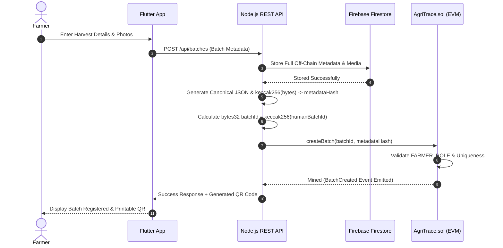
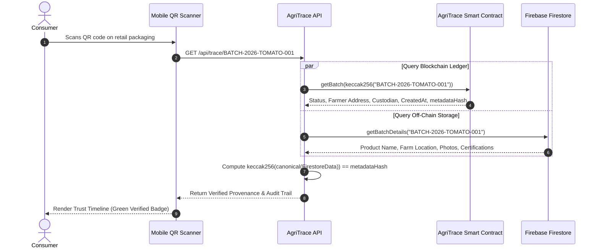

# AgriTrace: Blockchain Data Model & Architecture Design

> **Document Version**: 1.2.0<br/>
> **Status**: Approved Specification (Refined)<br/>
> **Target Platform**: Ethereum-compatible Blockchain (Hardhat / EVM)<br/>
> **Ecosystem Integration**: Node.js REST API + Firebase Cloud Firestore + Flutter Client

---

## 1. Product Batch Model & Storage Strategy

In agricultural logistics, physical goods move across distinct organizations. To achieve optimal gas efficiency, maintain clean architectural boundaries, and respect EVM storage constraints, AgriTrace splits batch information into:
1. **On-Chain Minimal Trust Anchor** (`ProductBatch` struct)
2. **Off-Chain Canonical Metadata** (Firebase Cloud Firestore & Storage)

### 1.1 Batch Identifier Design (`bytes32`)

* **On-Chain Identifier**: A fixed-size `bytes32` identifier.
* **Human-Readable Business Identifier**: The application and mobile UI present human-friendly IDs, such as:
  ```text
  BATCH-2026-TOMATO-001
  ```
* **Deterministic Derivation**: The backend and client derive the `bytes32` key deterministically using Ethereum's native cryptographic hashing function:
  $$\text{batchId} = \text{keccak256}(\text{bytes}(\text{"BATCH-2026-TOMATO-001"}))$$
* **Technical Advantages**:
  * **EVM Efficiency**: `bytes32` fits natively into a single 256-bit EVM word, eliminating dynamic string allocation overhead and reducing `SSTORE` gas costs.
  * **Deterministic Mapping**: Direct O(1) key lookups in Solidity mappings (`mapping(bytes32 => ProductBatch)`).
  * **Collateral Collision Resistance**: Keccak-256 guarantees unique identifiers across different cooperatives and crops.

### 1.2 On-Chain Data Structure (`ProductBatch`)

The on-chain contract stores **zero verbose product text, zero personal details, and zero media files**. It retains only the state machine variables and cryptographic anchors:

```solidity
enum BatchStatus {
    CREATED,            // 0: Batch registered by Farmer
    QUALITY_VERIFIED,   // 1: Inspected and approved by Quality Inspector
    QUALITY_REJECTED,   // 2: Terminal state: Failed quality inspection
    IN_TRANSIT,         // 3: Under custody of Transporter
    AT_WAREHOUSE,       // 4: Received and held by Warehouse / Processor
    AT_RETAILER,        // 5: Received and stocked by Retailer
    DELIVERED           // 6: Terminal state: Handed over / sold to Consumer
}

struct ProductBatch {
    bytes32 batchId;          // Keccak-256 hash of human-readable batch ID
    address farmer;           // Originating grower (immutable provenance anchor)
    address currentCustodian; // Entity currently holding authorized physical custody
    BatchStatus status;       // Current lifecycle state
    uint256 createdAt;        // Block timestamp when batch was registered
    bytes32 metadataHash;     // Keccak-256 hash of canonical off-chain metadata
}
```

#### Field-by-Field Rationale

| Field | Type | Storage | Justification |
|---|---|---|---|
| `batchId` | `bytes32` | **On-Chain** | Native EVM word. Uniquely identifies the batch in contract mappings. |
| `farmer` | `address` | **On-Chain** | 20-byte address of the grower. Proves origin permanently; cannot be altered. |
| `currentCustodian` | `address` | **On-Chain** | 20-byte address of the party holding active physical custody. Governs handover authorization. |
| `status` | `BatchStatus` | **On-Chain** | 8-bit integer enum. Enforces strict state progression. |
| `createdAt` | `uint256` | **On-Chain** | Block timestamp (`block.timestamp`). Provides a tamper-proof registration record. |
| `metadataHash` | `bytes32` | **On-Chain** | 32-byte cryptographic anchor. Guarantees the integrity of off-chain Firestore data. |

### 1.3 Off-Chain Data Structure (Firebase Cloud Firestore)

All descriptive, voluminous, and searchable crop attributes live off-chain in Firebase Cloud Firestore:

* `humanBatchId`: `"BATCH-2026-TOMATO-001"`
* `productName`: `"Organic Roma Tomatoes"`
* `category`: `"Vegetables / Fresh Produce"`
* `quantity`: `1500`
* `unit`: `"kg"`
* `origin`: `"Green Valley Farm, Nashik, Maharashtra, India"`
* `harvestDate`: `"2026-09-29T10:00:00Z"`
* `cropVariety`: `"Solanum lycopersicum (Roma VF)"`
* `farmCertifications`: `["India Organic", "NPOP Certified"]`
* `photos`: `["https://storage.googleapis.com/.../field.jpg", "https://storage.googleapis.com/.../crate.jpg"]`
* `labReports`: `["https://storage.googleapis.com/.../residue_report.pdf"]`

---

## 2. Canonical Metadata Hashing Strategy

To prevent ambiguous hash collisions and ensure that different platforms (Node.js backend, Flutter mobile app, or independent auditors) generate the exact same hash for identical metadata, AgriTrace establishes a **Strict Canonical Serialization Standard**.

### 2.1 The Hashing Pipeline

```text
Off-Chain JSON Data
        ↓
Canonicalization (Sort keys alphabetically, strip whitespace, normalize UTF-8)
        ↓
Deterministic UTF-8 String
        ↓
keccak256(canonicalBytes)
        ↓
bytes32 metadataHash
        ↓
Committed On-Chain via Smart Contract
```

### 2.2 Canonical JSON Specification

Before computing `keccak256`, the metadata payload is normalized into the following deterministic schema with keys sorted alphabetically:

```json
{
  "category": "Vegetables / Fresh Produce",
  "harvestDate": "2026-09-29T10:00:00Z",
  "humanBatchId": "BATCH-2026-TOMATO-001",
  "origin": "Green Valley Farm, Nashik, Maharashtra, India",
  "productName": "Organic Roma Tomatoes",
  "quantity": 1500,
  "unit": "kg"
}
```

* **Deterministic Computation**: In Node.js / Dart:
  $$\text{metadataHash} = \text{ethers.keccak256}(\text{toUtf8Bytes}(\text{canonicalJsonString}))$$
* **Verification Guarantee**: If anyone modifies the quantity, harvest date, or origin in Firestore, re-running `keccak256` produces a mismatched hash, instantly triggering an on-screen tamper alert on the mobile app.

---

## 3. Custody vs. Ownership Terminology

In supply chain tracking, physical control is distinct from legal ownership:
* A transporter transporting produce on highway routes holds physical custody, not commercial ownership.
* A cold storage warehouse holding inventory provides custodial storage.

Therefore, AgriTrace strictly utilizes the terminology **`currentCustodian`** rather than "owner":
* Reflects verifiable, physical responsibility and chain of custody.
* Clarifies that transferring custody represents a documented handover of goods between verified supply chain actors.

---

## 4. Batch Lifecycle State Machine

AgriTrace implements an MVP lifecycle specifically tailored to agricultural produce logistics:

```text
                 [1. Registration]
                      FARMER
                         ↓
                    +---------+
                    | CREATED |
                    +---------+
                         ↓
               [2. Quality Audit]
                QUALITY_INSPECTOR
                   /           \
           (Pass) /             \ (Fail)
                 v               v
          +------------------+   +-------------------+
          | QUALITY_VERIFIED |   | QUALITY_REJECTED  | (Terminal State)
          +------------------+   +-------------------+
                 ↓
         [3. Logistics Pickup]
               TRANSPORTER
                 ↓
          +------------+
          | IN_TRANSIT |
          +------------+
                 ↓
        [4. Warehouse Intake]
         WAREHOUSE / PROCESSOR
                 ↓
          +--------------+
          | AT_WAREHOUSE |
          +--------------+
                 ↓
        [5. Retail Stocking]
              RETAILER
                 ↓
          +-------------+
          | AT_RETAILER |
          +-------------+
                 ↓
         [6. Consumer Sale]
              RETAILER
                 ↓
          +-----------+
          | DELIVERED | (Terminal State)
          +-----------+
```

### 4.1 State Machine Rules

1. **State Preservation**: A batch can only transition forward along approved paths.
2. **Terminal Rejection**: If `QUALITY_REJECTED` is triggered by an inspector (e.g., failed pesticide or moisture tolerance thresholds), the batch cannot be passed to transit or retail.
3. **Milestones without State Explosion**: Routine operational checkpoints (e.g., GPS tracking pings, temperature check logs, customs clearances) do **not** create separate state machine enums. They are recorded as lightweight **Supply Chain Milestone Events** linked to the current state.

---

## 5. User Roles & Permission Model

AgriTrace implements strict, role-based boundaries. Crucially, **the Admin role is purely administrative and has zero arbitrary data manipulation authority**.

### 5.1 Role Definitions & Permission Matrix

| Role | Authorized On-Chain Actions | Explicit Restrictions |
|---|---|---|
| **Admin** | Register authorized participant addresses; grant/revoke actor roles (`FARMER_ROLE`, `INSPECTOR_ROLE`, etc.). | **CANNOT** create batches, alter batch statuses, rewrite timestamps, modify farmer addresses, change metadata hashes, or impersonate actors. |
| **Farmer** | Execute `createBatch()`; execute initial `transferCustody()` to an authorized Transporter. | **CANNOT** verify their own crop quality; cannot skip straight to retail. |
| **Quality Inspector** | Execute `verifyQuality()` (transitions to `QUALITY_VERIFIED` or `QUALITY_REJECTED`). | **CANNOT** create batches or take custody of produce. |
| **Transporter** | Accept custody of verified batches; update state to `IN_TRANSIT`; log transit milestone events. | **CANNOT** alter quality status; cannot mark produce as delivered to consumers. |
| **Warehouse / Processor** | Accept custody of transit batches; update state to `AT_WAREHOUSE`; log storage milestones. | **CANNOT** re-verify rejected produce. |
| **Retailer** | Accept custody of warehouse batches; update state to `AT_RETAILER`; execute final `completeDelivery()`. | **CANNOT** alter origin farm address or harvest metadata. |
| **Consumer** | **Read-only verification**. Query `getBatch()` and audit historical events. | **Zero write privileges**. Cannot invoke state-changing transactions. |

---

## 6. Smart Contract Functions Specification (`AgriTrace.sol`)

The smart contract will expose the following clean, defensive interface:

### 6.1 `createBatch(bytes32 batchId, bytes32 metadataHash)`
* **Caller**: Must have `FARMER_ROLE`.
* **Validation**:
  * `batchId != bytes32(0)`
  * `metadataHash != bytes32(0)`
  * `batches[batchId].createdAt == 0` (Ensures uniqueness; prevents duplicate batch overwrite).
* **State Change**:
  * Sets `farmer = msg.sender`, `currentCustodian = msg.sender`.
  * Sets `status = BatchStatus.CREATED`.
  * Sets `createdAt = block.timestamp`.
  * Sets `metadataHash = metadataHash`.
* **Emits**: `BatchCreated(batchId, msg.sender, metadataHash, block.timestamp)`.

### 6.2 `verifyQuality(bytes32 batchId, bool approved, bytes32 reportHash)`
* **Caller**: Must have `INSPECTOR_ROLE`.
* **Validation**:
  * Batch must exist (`createdAt != 0`).
  * `status == BatchStatus.CREATED`.
* **State Change**:
  * If `approved == true`: `status = BatchStatus.QUALITY_VERIFIED`.
  * If `approved == false`: `status = BatchStatus.QUALITY_REJECTED`.
* **Emits**: `QualityAuditCompleted(batchId, msg.sender, approved, reportHash, block.timestamp)`.

### 6.3 Direct Custody Transfer: `transferCustody`
```solidity
function transferCustody(
    bytes32 batchId,
    address newCustodian,
    BatchStatus targetStatus,
    bytes32 handoverHash
) external
```
* **Caller**: Must be active `currentCustodian` of the batch.
* **Validation**:
  * Batch must exist (`createdAt != 0`).
  * `msg.sender == batches[batchId].currentCustodian`.
  * `newCustodian != address(0)` and `newCustodian != msg.sender`.
  * `handoverHash != bytes32(0)` (cryptographic anchor of physical handover / bill of lading).
  * Target status must be the valid sequential successor:
    * `QUALITY_VERIFIED` $\rightarrow$ `IN_TRANSIT` (requires `TRANSPORTER_ROLE` on `newCustodian`).
    * `IN_TRANSIT` $\rightarrow$ `AT_WAREHOUSE` (requires `WAREHOUSE_ROLE` on `newCustodian`).
    * `AT_WAREHOUSE` $\rightarrow$ `AT_RETAILER` (requires `RETAILER_ROLE` on `newCustodian`).
* **State Change**:
  * `batches[batchId].currentCustodian = newCustodian`.
  * `batches[batchId].status = targetStatus`.
  * Clears any active pending transfer (`if (pendingCustodyTransfers[batchId].active) delete pendingCustodyTransfers[batchId]`).
* **Emits**: `CustodyTransferred(batchId, msg.sender, newCustodian, targetStatus, handoverHash, block.timestamp)`.

---

### 6.4 Two-Step Custody Handover Mechanism

To support real-world logistics where physical custody handovers require mutual agreement between the departing custodian and the arriving custodian, AgriTrace supports an explicit two-step transfer workflow:

#### Distinction: Direct vs. Two-Step Transfers
| Feature | Direct Transfer (`transferCustody`) | Two-Step Handover (`initiate` $\rightarrow$ `accept`) |
|---|---|---|
| **Handshake** | 1-step immediate transfer | 2-step mutual confirmation |
| **Recipient Action** | Passive (recipient does not sign a transaction) | Active (recipient must sign `acceptCustody`) |
| **Cancellation** | N/A (immediate completion) | Supported via `cancelCustodyTransfer` prior to acceptance |
| **Use Case** | Automated backend dispatch, fast handoffs | Formal physical cargo handover, inspection on arrival |

#### 6.4.1 `initiateCustodyTransfer(bytes32 batchId, address newCustodian, BatchStatus targetStatus, bytes32 handoverHash)`
* **Caller**: Active `currentCustodian`.
* **Validation**: Enforces identical transition, recipient role, and non-zero `handoverHash` checks as direct transfer.
* **State Change**: Records `PendingCustodyTransfer` mapping entry with `active = true`.
* **Emits**: `CustodyTransferInitiated(batchId, msg.sender, newCustodian, targetStatus, handoverHash, block.timestamp)`.

#### 6.4.2 `cancelCustodyTransfer(bytes32 batchId)`
* **Caller**: Active `currentCustodian`.
* **Validation**:
  * Batch exists.
  * `msg.sender == currentCustodian`.
  * `pendingCustodyTransfers[batchId].active == true`.
* **State Change**: Deletes `pendingCustodyTransfers[batchId]`. Preserves active batch status and current custodian unchanged.
* **Emits**: `CustodyTransferCancelled(batchId, msg.sender, block.timestamp)`.

#### 6.4.3 `acceptCustody(bytes32 batchId, bytes32 acceptanceHash)`
* **Caller**: Must be designated `newCustodian` from active pending transfer.
* **Validation**:
  * Batch exists.
  * Batch is not in terminal states (`QUALITY_REJECTED` or `DELIVERED`).
  * `pendingCustodyTransfers[batchId].active == true` (strictly requires active pending transfer; prevents repeated confirmations).
  * `acceptanceHash != bytes32(0)` (physical receipt / condition inspection anchor).
  * `msg.sender == pending.newCustodian`.
  * **Dynamic Role Revalidation**: Re-verifies recipient still holds required role (`TRANSPORTER_ROLE`, `WAREHOUSE_ROLE`, or `RETAILER_ROLE`) at acceptance time, preventing revoked actors from claiming custody.
* **State Change**:
  * `batches[batchId].currentCustodian = msg.sender`.
  * `batches[batchId].status = pending.targetStatus`.
  * Deletes `pendingCustodyTransfers[batchId]`.
* **Emits**:
  * `CustodyTransferred(batchId, previousCustodian, msg.sender, targetStatus, handoverHash, block.timestamp)`
  * `CustodyAccepted(batchId, msg.sender, targetStatus, acceptanceHash, block.timestamp)`

---

### 6.5 `completeDelivery(bytes32 batchId)`
* **Caller**: Must be `currentCustodian` and possess `RETAILER_ROLE`.
* **Validation**:
  * Batch exists.
  * `msg.sender == batches[batchId].currentCustodian`.
  * `hasRole(RETAILER_ROLE, msg.sender)`.
  * `status == BatchStatus.AT_RETAILER`.
* **State Change**:
  * `batches[batchId].status = BatchStatus.DELIVERED` (terminal state).
* **Emits**: `BatchDelivered(batchId, msg.sender, block.timestamp)`.

---

### 6.6 `logMilestone(bytes32 batchId, string action, bytes32 milestoneHash)`
* **Caller**: Must be active `currentCustodian`.
* **Validation**: Batch exists, is not in a terminal state (`QUALITY_REJECTED` or `DELIVERED`), `bytes(action).length > 0`, and `milestoneHash != bytes32(0)`.
* **State Change**: Appends `Milestone` struct to on-chain history array.
* **Emits**: `MilestoneLogged(batchId, msg.sender, action, milestoneHash, block.timestamp)`.

---

### 6.7 View & Query Functions
* `getBatch(bytes32 batchId)`: Returns complete `ProductBatch` struct.
* `batchExists(bytes32 batchId)`: Returns boolean existence check.
* `getMilestones(bytes32 batchId)`: Returns complete milestone array.
* `getMilestoneCount(bytes32 batchId)`: Returns total count of milestones.
* `getMilestone(bytes32 batchId, uint256 index)`: Returns individual milestone by index.
* `getAllBatchIds()`: Returns array of all registered batch IDs.
* `getBatchCount()`: Returns total count of registered batches.

---

## 7. Solidity Events

Events provide an append-only, low-cost audit trail accessible to frontend clients and backend indexers:

```solidity
event BatchCreated(
    bytes32 indexed batchId,
    address indexed farmer,
    bytes32 metadataHash,
    uint256 timestamp
);

event QualityAuditCompleted(
    bytes32 indexed batchId,
    address indexed inspector,
    bool approved,
    bytes32 reportHash,
    uint256 timestamp
);

event CustodyTransferInitiated(
    bytes32 indexed batchId,
    address indexed currentCustodian,
    address indexed newCustodian,
    BatchStatus targetStatus,
    bytes32 handoverHash,
    uint256 timestamp
);

event CustodyTransferCancelled(
    bytes32 indexed batchId,
    address indexed custodian,
    uint256 timestamp
);

event CustodyTransferred(
    bytes32 indexed batchId,
    address indexed previousCustodian,
    address indexed newCustodian,
    BatchStatus newStatus,
    bytes32 handoverHash,
    uint256 timestamp
);

event CustodyAccepted(
    bytes32 indexed batchId,
    address indexed custodian,
    BatchStatus status,
    bytes32 acceptanceHash,
    uint256 timestamp
);

event BatchDelivered(
    bytes32 indexed batchId,
    address indexed retailer,
    uint256 timestamp
);

event MilestoneLogged(
    bytes32 indexed batchId,
    address indexed actor,
    string action,
    bytes32 milestoneHash,
    uint256 timestamp
);
```

---

## 8. On-Chain vs. Off-Chain Decision Matrix

| Dimension | On-Chain (Solidity / EVM) | Off-Chain (Firebase Cloud Firestore & Storage) |
|---|---|---|
| **Stored Content** | Fixed-size 32-byte hashes (`batchId`, `metadataHash`), addresses (`farmer`, `currentCustodian`), 8-bit status enum, timestamps. | Crop descriptions, harvest notes, high-res photos, PDF lab certificates, GPS track breadcrumbs, farmer biographies. |
| **Why Here** | Guarantees tamper-proofing, non-repudiation, and independent auditability. | High volume, cost efficiency, fast search/filtering, UI rendering. |
| **Storage Cost Profile** | **High**: Storage in EVM (`SSTORE`) costs 20,000 gas per 32-byte word. Storing a 500 KB photo on-chain would cost thousands of dollars. | **Extremely Low**: Cloud storage costs fractions of a cent per gigabyte. |
| **Trust Linkage** | **Anchor of Trust**: The on-chain `metadataHash` locks off-chain data. Any unauthorized database edit breaks `keccak256(dbData) == onChainHash`. | Rich contextual experience for consumers. |

---

## 9. QR Code Design & Resolution Flow

### 9.1 QR Code Content
The physical QR code printed on consumer packaging contains **only the safe, human-readable batch identifier**:

```json
{
  "app": "agritrace",
  "v": "1.0",
  "batchId": "BATCH-2026-TOMATO-001"
}
```

*Or as a standard URL format:*
`https://agritrace.app/verify/BATCH-2026-TOMATO-001`

**Strict Privacy Rules**:
* ❌ **No private keys, passwords, or seed phrases**
* ❌ **No personal farmer contact details or phone numbers**
* ❌ **No uncompressed JSON payloads**

### 9.2 Consumer Resolution & Verification Workflow

1. **Scan**: Consumer scans QR code via the Flutter mobile app.
2. **Deterministic Derivation**: App computes `bytes32 batchIdKey = keccak256(toUtf8Bytes(batchId))`.
3. **Parallel Fetch**:
   * **Blockchain Read**: Calls `AgriTrace.getBatch(batchIdKey)` via RPC (Zero gas cost).
   * **Firestore Read**: Fetches canonical metadata document and media assets.
4. **Cryptographic Integrity Verification**:
   * App normalizes the Firestore document to canonical JSON.
   * Computes `localHash = keccak256(canonicalBytes)`.
   * Asserts: `localHash == onChainBatch.metadataHash`.
   * **Match**: Displays a verified green checkmark with origin details and full custody timeline.
   * **Mismatch**: Displays a red warning banner indicating metadata tampering.

---

## 10. Security & Threat Modeling

| Threat Vector | Mitigation Strategy in AgriTrace Architecture |
|---|---|
| **Unauthorized Custody Claim** | Handover requires `msg.sender == currentCustodian`. Strangers cannot claim or transfer goods. |
| **Invalid Stage Skipping** | Strict validation in `transferCustody()` enforcing allowed state progression. |
| **Rogue Admin Tampering** | Admin privileges are strictly limited to role assignment. Admin contracts cannot alter batch status, history, or metadata. |
| **Duplicate Batch Injection** | `createBatch()` verifies `batches[batchId].createdAt == 0`, preventing overwriting active or historical batches. |
| **Replay / Front-Running** | All transactions are signed by participant private keys; EVM nonces prevent transaction replays. |
| **Data Poisoning in Database** | Cryptographic anchoring via `keccak256` ensures any off-chain modification is immediately exposed. |
| **Consumer Denial of Service** | Verification functions are `external view` queries requiring zero wallet connections, gas tokens, or transaction submissions. |

---

## 11. System Architecture Diagrams

### 11.1 Harvest Registration & On-Chain Anchoring



### 11.2 Consumer Scan & Cryptographic Verification



---

## 12. Gas Optimization Summary for Viva & Defense

During academic defense and hackathon evaluations, the gas efficiency rationale can be summarized in three points:

1. **Word-Sized Storage Types**:
   * Storing `bytes32 batchId` and `bytes32 metadataHash` rather than dynamic strings saves tens of thousands of gas units per batch creation by eliminating string length headers and dynamic memory expansions.
2. **Fixed Slot Packing**:
   * `address farmer` (20 bytes) + `BatchStatus status` (1 byte) = 21 bytes, which cleanly pack into a single 32-byte EVM storage slot.
   * `address currentCustodian` (20 bytes) packs into the adjacent slot.
3. **Zero-Gas Consumer Verification**:
   * Because `getBatch` is a `view` function, consumers and retailers query the blockchain for **0 gas cost** via free JSON-RPC eth_call requests.
