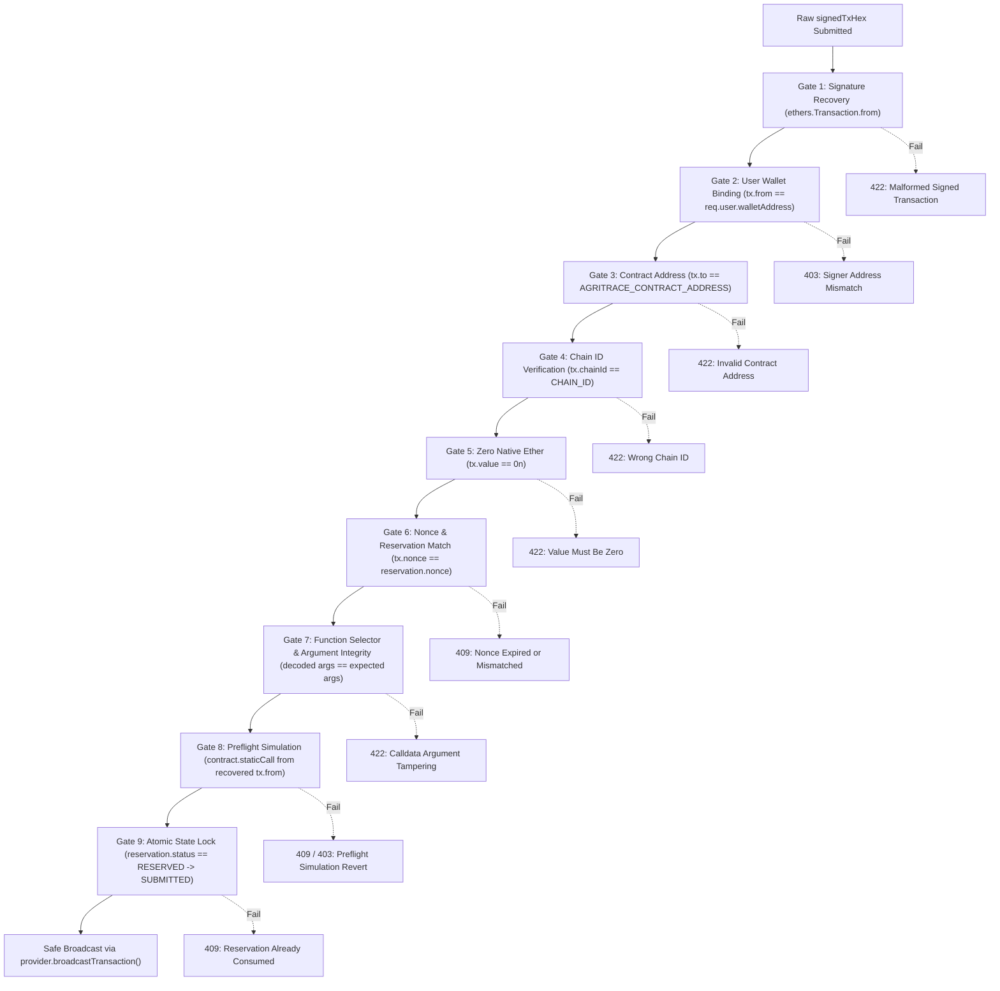

# AgriTrace Non-Custodial Transaction Submission Architecture & Security Specification

> **Document Version**: 1.5.0  
> **Status**: Final Approved Design Specification with Reorg Occurrence Identity & Pure Firestore Atomicity  
> **Author**: AgriTrace Architecture & Core Engineering Team  
> **Target Framework**: Node.js (v20+ LTS) + Express.js  
> **Persistence**: Google Cloud Firestore (Optimistic Concurrency Control)  
> **Blockchain Integration**: ethers.js v6.17.0 + AgriTrace Smart Contract ([`AgriTrace.sol`](file:///c:/Users/pheon/OneDrive/Desktop/AgriTrace/blockchain/contracts/AgriTrace.sol))  
> **Client Platform**: Flutter Mobile Application (Local Secure Keystore / Hardware Wallet)  

---

## 1. Executive Summary & Non-Custodial Principles

The AgriTrace transaction submission architecture provides a **strictly non-custodial**, auditable, and resilient bridge between off-chain supply chain actors and the on-chain Ethereum smart contract.

In supply chain tracking, physical participants (Farmers, Quality Inspectors, Transporters, Warehouse Managers, Retailers) perform state transitions that are legally and operationally binding. The smart contract strictly verifies physical identity via EVM execution:
```solidity
require(msg.sender == currentCustodian, "Caller is not current custodian");
require(newCustodian != msg.sender, "Cannot transfer custody to self");
```

Therefore, the backend **must never sign transactions on behalf of participants**, and **must never store, generate, transmit, or custody participant private keys or seed phrases**.

```
                                      THE AGY ZERO-CUSTODY INVARIANT
 ┌───────────────────────────────────────────────────────────────────────────────────────────────────┐
 │ 1. Private keys remain exclusively in client-side secure hardware (flutter_secure_storage/SecureEnclave).│
 │ 2. Backend servers hold ZERO private keys, ZERO seed phrases, and NEVER execute Wallet.signTransaction().│
 │ 3. The backend functions strictly as an untrusted validation engine, nonce manager, and mempool relay.│
 │ 4. Firebase Authentication (Web2 Identity) is cryptographically bound to, but strictly isolated from,  │
 │    Ethereum Transaction Signing (Web3 Non-Custodial Keys).                                       │
 │ 5. Wallet-linking message signatures (EIP-191) are NEVER treated as transaction signatures.      │
 └───────────────────────────────────────────────────────────────────────────────────────────────────┘
```

---

## 2. End-to-End Sequence Diagram

The submission architecture operates through a defensive **Two-Phase Commit Protocol**:
1. **Phase 1 (Preparation & Nonce Reservation)**: Backend validates business constraints, derives cryptographic anchor hashes, reserves the next sequential nonce via atomic Firestore mutex, and encodes the unsigned transaction calldata.
2. **Phase 2 (Client-Side Signing & Relaying)**: The mobile client signs the exact payload with its local private key, submits the signed raw transaction (`signedTxHex`), and the backend verifies all parameters before broadcasting to the EVM network.

```mermaid
sequenceDiagram
    autonumber
    actor Participant as Participant (Mobile Client)
    participant AuthMW as Auth & Role Middleware
    participant PrepCtrl as Prepare Controller
    participant NonceMgr as Nonce Reservation Manager
    participant Firestore as Cloud Firestore (OCC)
    participant RPC as Ethereum RPC Node
    participant SubmitCtrl as Submit Controller
    participant SignerMW as Signer & Payload Validator
    participant EVM as EVM Blockchain (Hardhat / Testnet)
    participant Recon as Reconciliation Worker

    Note over Participant,PrepCtrl: Phase 1: Transaction Preparation & Nonce Reservation
    Participant->>AuthMW: POST /api/v1/batches/prepare<br/>(Bearer ID Token + Batch Payload + IdempotencyKey)
    AuthMW->>Firestore: Verify UID, active profile, and business role
    AuthMW-->>PrepCtrl: Authenticated User Profile (uid, walletAddress, role)
    PrepCtrl->>RPC: eth_call preflight (hasRole, getBatch, currentCustodian)
    PrepCtrl->>NonceMgr: reserveNonce(walletAddress, uid, targetFunction, idempotencyKey)
    NonceMgr->>Firestore: Atomic runTransaction: verify max 1 active reservation, read tracker, allocate max(rpcPending, highestReserved + 1)
    Firestore-->>NonceMgr: reservationId + assignedNonce
    NonceMgr-->>PrepCtrl: reservationId + assignedNonce
    PrepCtrl-->>Participant: 200 OK { to, data, nonce, reservationId, gasLimit, maxFeePerGas, chainId }

    Note over Participant: Phase 2: Local Client-Side Signing
    Participant->>Participant: Wallet.signTransaction(txData) -> signedTxHex

    Note over Participant,SubmitCtrl: Phase 3: Signed Raw Transaction Submission
    Participant->>AuthMW: POST /api/v1/batches<br/>(signedTxHex + reservationId + idempotencyKey + metadata)
    AuthMW-->>SubmitCtrl: Authenticated Request
    SubmitCtrl->>SignerMW: validateSignedTransaction(signedTxHex, reservationId)
    SignerMW->>SignerMW: Recover tx.from via ethers.Transaction.from(signedTxHex)
    SignerMW->>SignerMW: Assert tx.from == user.walletAddress<br/>Assert tx.to == AGRITRACE_CONTRACT_ADDRESS<br/>Assert tx.chainId == CHAIN_ID<br/>Assert tx.value == 0n
    SignerMW->>SignerMW: Decode calldata: assert selector & args match reservation payload
    SignerMW->>SignerMW: Preflight staticCall simulation with recovered tx.from
    SignerMW->>Firestore: Atomic runTransaction: verify reservationId, assert tx.nonce == reservation.nonce, mark SUBMITTED
    SignerMW-->>SubmitCtrl: Validation Passed
    
    SubmitCtrl->>Firestore: Write Batch Document (syncStatus: PENDING_BLOCKCHAIN, txHash)
    SubmitCtrl->>RPC: provider.broadcastTransaction(signedTxHex)
    alt Broadcast Accepted
        RPC-->>SubmitCtrl: txResponse (Mempool Admission Confirmed, txHash)
        SubmitCtrl-->>Participant: 202 Accepted { humanBatchId, txHash, reservationId, status: "PENDING_BLOCKCHAIN" }
    else Broadcast Rejected Synchronously
        RPC-->>SubmitCtrl: RPC Rejection Error (e.g. nonce too low, intrinsic gas)
        SubmitCtrl->>Firestore: Update syncStatus = FAILED_AT_BROADCAST
        SubmitCtrl-->>Participant: 409 / 422 Error (Transaction rejected by network)
    else Network Timeout / Socket Drop
        RPC--xSubmitCtrl: Timeout / Socket Drop
        SubmitCtrl->>Firestore: Update syncStatus = RECONCILIATION_REQUIRED
        SubmitCtrl-->>Participant: 202 Accepted { humanBatchId, txHash, status: "RECONCILIATION_REQUIRED" }
    end

    Note over SubmitCtrl,EVM: Phase 4: Asynchronous Receipt Polling & Finality
    par Confirmation Monitoring
        SubmitCtrl->>RPC: Poll getTransactionReceipt(txHash) / wait(CONFIRMATION_BLOCKS)
        EVM-->>RPC: Block Mined with Transaction
        RPC-->>SubmitCtrl: receipt (status == 1, blockNumber, gasUsed)
        SubmitCtrl->>Firestore: Idempotent commit: syncStatus = CONFIRMED, on-chain state finalized
    and Periodic Background Health
        Recon->>Firestore: Scan PENDING_BLOCKCHAIN / RECONCILIATION_REQUIRED
        Recon->>RPC: Forensic Investigation of Nonce & Receipts
    end
```

---

## 3. Transaction State Machine & Dual-Plane Lifecycle

Transaction lifecycle management distinguishes between **Client-Internal States** and **Backend-Observable States**, accounting for network timeouts and ambiguous broadcast outcomes:

```mermaid
stateDiagram-v2
    %% Client-Side States
    state "Client-Side: Local Device" as ClientPlane {
        [*] --> UNPREPARED
        UNPREPARED --> PREPARED: Receives unsigned payload from /prepare
        PREPARED --> SIGNING: Biometric / keystore prompt
        SIGNING --> SIGNED_OFFLINE: Raw transaction signed locally
        SIGNED_OFFLINE --> TRANSMITTING: POST /submit initiated
    }

    %% Backend-Observable States
    state "Backend-Observable: Firestore State Machine" as BackendPlane {
        [*] --> RESERVED: /prepare creates reservationId with assignedNonce
        RESERVED --> SUBMITTED: POST /submit passes 9 validation gates & staticCall
        
        SUBMITTED --> PENDING_BLOCKCHAIN: Broadcast accepted into mempool (txHash confirmed)
        SUBMITTED --> FAILED_AT_BROADCAST: Synchronous RPC rejection (nonce too low, intrinsic gas)
        SUBMITTED --> RECONCILIATION_REQUIRED: Network timeout / socket reset during broadcast
        
        PENDING_BLOCKCHAIN --> CONFIRMED: receipt.status == 1 && confirmations >= CONFIRMATION_BLOCKS
        PENDING_BLOCKCHAIN --> FAILED_ON_CHAIN: receipt.status == 0 (EVM Revert)
        PENDING_BLOCKCHAIN --> REPLACED: Verified replacement mined (same sender, same nonce, different hash)
        PENDING_BLOCKCHAIN --> RECONCILIATION_REQUIRED: Mempool eviction or polling timeout (> 120s)
        
        RECONCILIATION_REQUIRED --> CONFIRMED: Receipt found on-chain (receipt.status == 1)
        RECONCILIATION_REQUIRED --> FAILED_ON_CHAIN: Receipt found on-chain (receipt.status == 0)
        RECONCILIATION_REQUIRED --> REPLACED: Verified replacement mined at same nonce
        RECONCILIATION_REQUIRED --> PENDING_BLOCKCHAIN: Verified present in mempool; resume polling
    }
```



### 3.1 Detailed State Definitions

| State | Plane | Description | In-Flight Guarantees |
|---|---|---|---|
| **`UNPREPARED`** | Client | User filling out form on mobile UI. | Pure local device UI state. |
| **`PREPARED`** | Client | Unsigned payload and `reservationId` received from backend. | Awaiting participant signature. |
| **`SIGNED_OFFLINE`**| Client | Transaction signed locally with private key in secure hardware. | Held in local queue if device is offline. |
| **`RESERVED`** | Backend | Nonce allocated and locked in `nonceReservations/{reservationId}`. | Nonce is monotonically reserved. `highestReservedNonce` advanced. At most 1 active reservation permitted per wallet. |
| **`SUBMITTED`** | Backend | Raw signed transaction received; 9 validation gates and `staticCall` passed. | Reservation locked as `SUBMITTED`. Prevents replay of same reservation. |
| **`PENDING_BLOCKCHAIN`** | Backend | Mempool admission confirmed by RPC (`txHash` returned, confirmations = 0). | API returns `202 Accepted`. Monitoring receipt. **NOT yet mined.** |
| **`FAILED_AT_BROADCAST`**| Backend | Synchronous RPC rejection before mempool entry (e.g. intrinsic gas, underpriced). | Nonce not consumed on-chain. Off-chain state not committed. |
| **`CONFIRMED`** | Backend | Transaction mined into a block with `receipt.status === 1` and confirmed by required depth. | Final success state. Off-chain batch status idempotently updated. |
| **`FAILED_ON_CHAIN`** | Backend | Transaction mined with `receipt.status === 0` (revert). | Revert reason extracted; uncommitted off-chain modifications rolled back. |
| **`REPLACED`** | Backend | Confirmed replaced by another transaction with same sender, same nonce, and different hash. | Original reservation marked `REPLACED`. Prevents phantom state updates. |
| **`RECONCILIATION_REQUIRED`**| Backend | Ambiguous state: broadcast timeout, mempool eviction, unverified nonce consumption. | Polling paused; background recovery worker investigates sender nonce and receipts. |

---

## 4. Firestore Persistence & Data Model

All nonce tracking and transaction records are managed in Cloud Firestore using **atomic transactions (`firestore.runTransaction`)** leveraging Optimistic Concurrency Control (OCC).

### 4.1 Collection: `walletNonceTrackers/{walletAddress}`
Maintains the monotonic reservation sequence per participant wallet. Document ID is the **canonical lowercase Ethereum address** (`ethers.getAddress(addr).toLowerCase()`).

```json
{
  "walletAddress": "0x70997970c51812dc3a010c7d01b50e0d17dc79c8",
  "highestReservedNonce": 6,
  "activeReservationId": "123e4567-e89b-12d3-a456-426614174000",
  "lastAllocatedAt": "2026-11-05T12:00:00.000Z",
  "updatedAt": "2026-11-05T12:00:00.000Z"
}
```

### 4.2 Collection: `nonceReservations/{reservationId}`
Represents an individual nonce reservation. Document ID is a unique UUIDv4.

```json
{
  "reservationId": "123e4567-e89b-12d3-a456-426614174000",
  "uid": "usr_farmer_8832a7b1",
  "walletAddress": "0x70997970C51812dc3A010C7d01b50e0d17dc79C8",
  "nonce": 6,
  "type": "NEW_TRANSACTION",
  "targetFunction": "createBatch",
  "callDataHash": "0x4e07408562bedb8b60ce05c1decfe3ad16b72230967de01f640b7e4729b49fce",
  "expectedArgs": {
    "batchId": "0x7078459f06a313998aff5f7192ae0fa5e58cf9823f4422a8073561b04462125e",
    "metadataHash": "0xbec1c34ae775c4e85a9d48774328d093061dadc4422fffb483384410e74e658e"
  },
  "idempotencyKey": "idem_batch_2026_001",
  "status": "RESERVED",
  "createdAt": "2026-11-05T12:00:00.000Z",
  "expiresAt": "2026-11-05T12:15:00.000Z",
  "submittedAt": null,
  "broadcastAt": null,
  "txHash": null,
  "replacementForTxHash": null
}
```

### 4.3 Subcollection: `batches/{humanBatchId}/blockchainTransactions/{txHash}`
Retains the complete auditable transaction history for each batch.

```json
{
  "txHash": "0x3f5c71a938c7150a581452932f913e64848d73b064c391753443a7522d057140",
  "reservationId": "123e4567-e89b-12d3-a456-426614174000",
  "signerAddress": "0x70997970C51812dc3A010C7d01b50e0d17dc79C8",
  "action": "createBatch",
  "nonce": 6,
  "status": "CONFIRMED",
  "blockNumber": 1042389,
  "gasUsed": "84320",
  "effectiveGasPrice": "1500000000",
  "confirmations": 2,
  "revertReason": null,
  "submittedAt": "2026-11-05T12:01:00.000Z",
  "confirmedAt": "2026-11-05T12:01:30.000Z"
}
```

### 4.4 Collection: `processedTransactions/{chainId}_{txHash}`
Dedicated idempotency, ordering, and reorg-tracking record for every blockchain transaction processed by the backend. Document ID is deterministically `${chainId}_${txHash.toLowerCase()}`.

```json
{
  "docId": "31337_0x3f5c71a938c7150a581452932f913e64848d73b064c391753443a7522d057140",
  "chainId": 31337,
  "txHash": "0x3f5c71a938c7150a581452932f913e64848d73b064c391753443a7522d057140",
  "blockHash": "0x892a7e4b9d3c5f6a1e8c7b6d5e4f3a2b1c0d9e8f7a6b5c4d3e2f1a0b9c8d7e6f",
  "blockNumber": 1042389,
  "transactionIndex": 2,
  "receiptStatus": 1,
  "confirmationCount": 12,
  "canonicalBlockVerified": true,
  "applied": true,
  "superseded": false,
  "humanBatchId": "BATCH-2026-TOMATO-001",
  "batchId": "0x7078459f06a313998aff5f7192ae0fa5e58cf9823f4422a8073561b04462125e",
  "sender": "0x70997970C51812dc3A010C7d01b50e0d17dc79C8",
  "nonce": 6,
  "targetFunction": "createBatch",
  "targetStatus": "CREATED",
  "targetStatusCode": 0,
  "appliedAt": "2026-11-05T12:01:30.000Z",
  "reverted": false,
  "revertReason": null,
  "events": [
    {
      "name": "BatchCreated",
      "logIndex": 0,
      "args": {
        "batchId": "0x7078459f06a313998aff5f7192ae0fa5e58cf9823f4422a8073561b04462125e",
        "farmer": "0x70997970C51812dc3A010C7d01b50e0d17dc79C8",
        "metadataHash": "0xbec1c34ae775c4e85a9d48774328d093061dadc4422fffb483384410e74e658e"
      }
    }
  ]
}
```

### 4.5 Subcollection: `batches/{humanBatchId}/events/{chainId}_{blockHash}_{txHash}_{logIndex}`
Stores every confirmed contract event occurrence independently from current batch status. Document ID is deterministically `${chainId}_${blockHash.toLowerCase()}_${txHash.toLowerCase()}_${logIndex}`.

Incorporating `blockHash` decouples **transaction identity** (`txHash`) from **event occurrence identity**, ensuring that if a transaction is re-included in a different block after a reorganisation, the new event occurrence does not overwrite the orphaned record.

```json
{
  "eventId": "31337_0x892a7e4b9d3c5f6a1e8c7b6d5e4f3a2b1c0d9e8f7a6b5c4d3e2f1a0b9c8d7e6f_0x3f5c71a938c7150a581452932f913e64848d73b064c391753443a7522d057140_0",
  "chainId": 31337,
  "blockHash": "0x892a7e4b9d3c5f6a1e8c7b6d5e4f3a2b1c0d9e8f7a6b5c4d3e2f1a0b9c8d7e6f",
  "txHash": "0x3f5c71a938c7150a581452932f913e64848d73b064c391753443a7522d057140",
  "blockNumber": 1042389,
  "logIndex": 0,
  "name": "BatchCreated",
  "signature": "BatchCreated(bytes32,address,bytes32,uint256)",
  "args": {
    "batchId": "0x7078459f06a313998aff5f7192ae0fa5e58cf9823f4422a8073561b04462125e",
    "farmer": "0x70997970C51812dc3A010C7d01b50e0d17dc79C8",
    "metadataHash": "0xbec1c34ae775c4e85a9d48774328d093061dadc4422fffb483384410e74e658e",
    "timestamp": 1793880090
  },
  "superseded": false,
  "canonical": true,
  "orphaned": false,
  "createdAt": "2026-11-05T12:01:30.000Z"
}
```

---

## 5. Nonce Reservation Algorithm & Monotonic Allocation

### 5.1 Mathematical Nonce Allocation Formula

Inside an atomic Firestore transaction (`firestore.runTransaction`):

$$\text{rpcPendingNonce} = \text{await provider.getTransactionCount}(\text{walletAddress}, \text{"pending"})$$
$$\text{latestMinedNonce} = \text{await provider.getTransactionCount}(\text{walletAddress}, \text{"latest"})$$

For a **New Transaction** (`type: "NEW_TRANSACTION"`):
$$\text{assignedNonce} = \max\left(\text{rpcPendingNonce}, \text{tracker.highestReservedNonce} + 1\right)$$
*(If `tracker.highestReservedNonce` is missing or $< \text{rpcPendingNonce}$, $\text{assignedNonce} = \text{rpcPendingNonce}$).*

For a **Replacement Transaction** (`type: "REPLACEMENT_TRANSACTION"`):
$$\text{assignedNonce} = \text{originalReservation.nonce}$$
*(Validates: $\text{latestMinedNonce} \le \text{assignedNonce} < \text{rpcPendingNonce}$).*

### 5.2 Nonce Reservation Algorithm with Single Uncommitted Reservation Invariant

```javascript
async function reserveNonceAtomic({ walletAddress, uid, targetFunction, expectedArgs, idempotencyKey, isReplacement = false, originalTxHash = null }) {
  const canonicalAddress = ethers.getAddress(walletAddress);
  const docId = canonicalAddress.toLowerCase();
  const trackerRef = firestore.collection("walletNonceTrackers").doc(docId);

  // Query RPC outside the Firestore transaction
  const [rpcPendingNonce, latestMinedNonce] = await Promise.all([
    provider.getTransactionCount(canonicalAddress, "pending"),
    provider.getTransactionCount(canonicalAddress, "latest"),
  ]);

  return await firestore.runTransaction(async (transaction) => {
    const trackerDoc = await transaction.get(trackerRef);
    let assignedNonce;
    let highestReserved = trackerDoc.exists ? trackerDoc.data().highestReservedNonce : -1;

    // 1. Idempotency check: if idempotencyKey already active, return existing reservation
    const existingSnap = await transaction.get(
      firestore.collection("nonceReservations")
        .where("idempotencyKey", "==", idempotencyKey)
        .where("walletAddress", "==", canonicalAddress)
        .limit(1)
    );
    if (!existingSnap.empty) {
      const existing = existingSnap.docs[0].data();
      if (existing.status === "RESERVED" || existing.status === "SUBMITTED") {
        return existing;
      }
    }

    // 2. Strict Invariant: Exactly ONE Outstanding Unsubmitted Reservation per Wallet
    if (!isReplacement && trackerDoc.exists && trackerDoc.data().activeReservationId) {
      const activeResRef = firestore.collection("nonceReservations").doc(trackerDoc.data().activeReservationId);
      const activeResDoc = await transaction.get(activeResRef);
      if (activeResDoc.exists && activeResDoc.data().status === "RESERVED") {
        const error = new Error("An uncommitted transaction preparation is already active for this wallet. Complete or cancel it on-chain before preparing a new transaction.");
        error.statusCode = 409;
        error.code = "ACTIVE_RESERVATION_EXISTS";
        error.details = { activeReservationId: trackerDoc.data().activeReservationId, nonce: activeResDoc.data().nonce };
        throw error;
      }
    }

    if (isReplacement) {
      const origResSnap = await transaction.get(
        firestore.collection("nonceReservations").where("txHash", "==", originalTxHash).limit(1)
      );
      if (origResSnap.empty) throw new Error("Original transaction not found for replacement");
      const origRes = origResSnap.docs[0].data();
      assignedNonce = origRes.nonce;
      if (assignedNonce < latestMinedNonce) throw new Error("Original transaction already mined");
    } else {
      assignedNonce = Math.max(rpcPendingNonce, highestReserved + 1);
      highestReserved = assignedNonce;
    }

    const reservationId = crypto.randomUUID();
    const reservationRef = firestore.collection("nonceReservations").doc(reservationId);

    const reservationData = {
      reservationId,
      uid,
      walletAddress: canonicalAddress,
      nonce: assignedNonce,
      type: isReplacement ? "REPLACEMENT_TRANSACTION" : "NEW_TRANSACTION",
      targetFunction,
      expectedArgs,
      idempotencyKey,
      status: "RESERVED",
      createdAt: new Date().toISOString(),
      expiresAt: new Date(Date.now() + 15 * 60 * 1000).toISOString(), // 15-minute validity window
      submittedAt: null,
      broadcastAt: null,
      txHash: null,
      replacementForTxHash: isReplacement ? originalTxHash : null,
    };

    transaction.set(reservationRef, reservationData);
    transaction.set(trackerRef, {
      walletAddress: canonicalAddress,
      highestReservedNonce: highestReserved,
      activeReservationId: reservationId,
      updatedAt: new Date().toISOString(),
    }, { merge: true });

    return reservationData;
  });
}
```

---

## 6. Pre-Broadcast Signed Transaction Validation Rules

Before transmitting `signedTxHex` to the EVM network via `provider.broadcastTransaction()`, the backend executes **9 mandatory verification gates**:



### 6.1 Calldata Tampering & Argument Substitution Prevention
How the backend prevents a user from modifying arguments outside the intended operation:
1. **Calldata Parsing**: Decodes calldata using the smart contract ABI:
   ```javascript
   const parsedTx = contract.interface.parseTransaction({ data: tx.data, value: tx.value });
   ```
2. **Function Selector Assertion**:
   ```javascript
   if (parsedTx.name !== reservation.targetFunction) {
     throw new UnprocessableEntityError(`Calldata function mismatch: expected ${reservation.targetFunction}, got ${parsedTx.name}`);
   }
   ```
3. **Cryptographic Argument Matching**:
   - For `createBatch(bytes32 batchId, bytes32 metadataHash)`:
     ```javascript
     const expectedBatchId = computeBatchId(req.body.humanBatchId);
     const expectedMetadataHash = computeMetadataHash(canonicalJson);
     if (parsedTx.args[0] !== expectedBatchId || parsedTx.args[1] !== expectedMetadataHash) {
       throw new UnprocessableEntityError("Calldata arguments do not match authorized canonical metadata");
     }
     ```
   - For `verifyQuality(bytes32 batchId, bool approved, bytes32 reportHash)`:
     ```javascript
     if (parsedTx.args[0] !== expectedBatchId || parsedTx.args[1] !== req.body.approved || parsedTx.args[2] !== expectedReportHash) {
       throw new UnprocessableEntityError("Calldata arguments do not match authorized inspection report");
     }
     ```
   - For `transferCustody(bytes32 batchId, address newCustodian, uint8 targetStatus, bytes32 handoverHash)`:
     ```javascript
     if (parsedTx.args[0] !== expectedBatchId || 
         ethers.getAddress(parsedTx.args[1]) !== ethers.getAddress(req.body.newCustodian) ||
         Number(parsedTx.args[2]) !== expectedTargetStatus ||
         parsedTx.args[3] !== expectedHandoverHash) {
       throw new UnprocessableEntityError("Calldata transfer parameters have been modified");
     }
     ```

---

## 7. Reconciliation Strategy & Forensic Nonce Investigation

Distributed blockchain systems face dropped mempool transactions, RPC timeouts, gas surges, and server restarts. The reconciliation worker ([`reconciliation.service.js`](file:///c:/Users/pheon/OneDrive/Desktop/AgriTrace/backend/src/services/reconciliation.service.js)) executes every 30 seconds:

```mermaid
flowchart TD
    Scan["Scan Firestore for PENDING_BLOCKCHAIN & RECONCILIATION_REQUIRED"] --> CheckReceipt["Query provider.getTransactionReceipt(txHash)"]
    
    CheckReceipt -->|Receipt Found && status == 1| CommitSuccess["Idempotent Commit to CONFIRMED_ON_CHAIN\nvia processedTransactions record"]
    CheckReceipt -->|Receipt Found && status == 0| CommitRevert["Idempotent Commit to FAILED_ON_CHAIN\nExtract EVM revert reason"]
    
    CheckReceipt -->|Receipt == null| CheckMempool["Query provider.getTransaction(txHash)"]
    CheckMempool -->|Tx in Mempool| InMempool["Keep PENDING_BLOCKCHAIN\nCheck age < 120s: continue polling"]
    CheckMempool -->|Tx Missing from Mempool| CheckNonce["Query provider.getTransactionCount(sender, 'latest')"]
    
    CheckNonce -->|latestMinedNonce <= tx.nonce| NonceUnconsumed["Nonce Unconsumed:\nTransaction dropped (underpriced gas)\nMark RECONCILIATION_REQUIRED\nPrompt Speed-Up / Replace"]
    CheckNonce -->|latestMinedNonce > tx.nonce| CheckReplacements["Nonce Consumed:\nSearch registered replacements in Firestore\nMatching: sender && nonce && hash != orig"]
    
    CheckReplacements -->|Replacement Receipt == 1| ReplacementMined["Mark original as REPLACED\nMark replacement as CONFIRMED"]
    CheckReplacements -->|No Registered Match| BlockScan["Block Transaction Scan (where RPC permits)\nSearch block.transactions for sender && nonce"]
    
    BlockScan -->|Block Tx Found (diff hash) && status == 1| ExternalReplacement["Confirmed Mined Replacement\nMark original as REPLACED"]
    BlockScan -->|Block Tx Found (diff hash) && status == 0| ExternalRevert["Replacement Reverted on Chain\nMark original as REPLACED"]
    BlockScan -->|Block Scan Unsupported / Exceeded| Unidentified["Retain RECONCILIATION_REQUIRED\nSub-status: UNIDENTIFIED_NONCE_CONSUMPTION"]
```

### 7.1 The Strict Evidence Rule
**The backend NEVER marks a transaction as `CONFIRMED` or `FAILED` without definitive on-chain evidence (`receipt.status`).**
- A timeout does NOT mean a transaction failed (it may be mined in the next block).
- A missing mempool entry does NOT mean a transaction failed (it may have been mined while the query was in-flight).
- If status cannot be determined with mathematical certainty, the document transitions to `RECONCILIATION_REQUIRED`.

### 7.2 Boot Scan on Application Restart
Upon server startup, the reconciliation service executes an immediate boot scan:
1. Queries all Firestore documents with `syncStatus: "PENDING_BLOCKCHAIN"` or `syncStatus: "RECONCILIATION_REQUIRED"`.
2. Queries receipts for each in-flight transaction. Any transactions mined while the API was restarting are cleanly committed to `CONFIRMED_ON_CHAIN` via the idempotent transaction-processing record.

---

## 8. REST API Specification (Step 3B.5 / 3B.6 Blueprint)

All endpoints require `Authorization: Bearer <FirebaseIdToken>`. Every transaction operation implements the symmetric **Two-Phase Commit Pattern** (`/prepare` + `/submit`).

### 8.1 Batch Registration (Farmer)
- `POST /api/v1/batches/prepare`: Validates anchored metadata; derives hashes; atomically reserves nonce; returns unsigned `createBatch` calldata.
- `POST /api/v1/batches`: Accepts `signedTxHex` + `reservationId` + metadata; validates 9 gates; writes `PENDING_BLOCKCHAIN`; broadcasts to mempool.

### 8.2 Quality Inspection (Inspector)
- `POST /api/v1/batches/:humanBatchId/inspect/prepare`: Validates inspection parameters; computes `reportHash`; atomically reserves nonce; returns unsigned `verifyQuality` calldata.
- `POST /api/v1/batches/:humanBatchId/inspect`: Submits signed `verifyQuality` raw transaction; validates inspector signer; broadcasts on-chain.

### 8.3 Custody Transfers
- **Direct Custody Handover**:
  - `POST /api/v1/batches/:humanBatchId/transfers/direct/prepare`: Validates recipient role and target status; computes `handoverHash`; reserves nonce; encodes unsigned `transferCustody` calldata.
  - `POST /api/v1/batches/:humanBatchId/transfers/direct`: Submits signed transaction for single-step `transferCustody`.
- **Two-Step Transfer Initiation**:
  - `POST /api/v1/batches/:humanBatchId/transfers/initiate/prepare`: Validates recipient role; computes `handoverHash`; reserves nonce; encodes unsigned `initiateCustodyTransfer` calldata.
  - `POST /api/v1/batches/:humanBatchId/transfers/initiate`: Submits signed transaction for two-step transfer initiation.
- **Two-Step Transfer Acceptance**:
  - `POST /api/v1/batches/:humanBatchId/transfers/accept/prepare`: Validates caller is designated recipient; computes `acceptanceHash`; reserves nonce; encodes unsigned `acceptCustody` calldata.
  - `POST /api/v1/batches/:humanBatchId/transfers/accept`: Submits signed transaction for `acceptCustody`.
- **Two-Step Transfer Cancellation**:
  - `POST /api/v1/batches/:humanBatchId/transfers/cancel/prepare`: Validates caller is current custodian; asserts pending transfer exists; reserves nonce; encodes unsigned `cancelCustodyTransfer` calldata.
  - `POST /api/v1/batches/:humanBatchId/transfers/cancel`: Submits signed transaction for `cancelCustodyTransfer`.

### 8.4 Operational Milestones & Delivery
- **Milestone Logging**:
  - `POST /api/v1/batches/:humanBatchId/milestones/prepare`: Reserves nonce and encodes unsigned `logMilestone` transaction data with `milestoneHash`.
  - `POST /api/v1/batches/:humanBatchId/milestones`: Submits signed transaction and records environmental telemetry in Firestore.
- **Delivery Completion (Retailer)**:
  - `POST /api/v1/batches/:humanBatchId/deliver/prepare`: Validates caller has `RETAILER_ROLE` and is custodian; reserves nonce; encodes unsigned `completeDelivery` calldata.
  - `POST /api/v1/batches/:humanBatchId/deliver`: Submits signed transaction for `completeDelivery`.

### 8.5 Speed-Up & Unsubmitted Reservation Cancellation
- **Speed-Up / Replace (For In-Flight Mined/Mempool Transactions)**:
  - `POST /api/v1/transactions/:txHash/speed-up/prepare`: Encodes replacement transaction with same nonce and +20% gas fee (`type: "REPLACEMENT_TRANSACTION"`).
  - `POST /api/v1/transactions/:txHash/speed-up`: Submits signed replacement transaction.
- **Unsubmitted Reservation Cancellation (Two-Phase On-Chain Self-Transaction)**:
  - `POST /api/v1/reservations/:reservationId/cancel/prepare`: Prepares unsigned 0-ETH self-transfer (`to = walletAddress`, `value = 0`, `data = 0x`, `nonce = reservation.nonce`) to close the unsubmitted slot on-chain.
  - `POST /api/v1/reservations/:reservationId/cancel`: Submits signed cancellation transaction, broadcasts to mempool, and waits for block confirmation before invalidating the reservation.

---

## 9. Comprehensive Security Threat Analysis & Mitigations

| # | Threat Scenario | Attack Vector | Architectural Mitigation |
|:---:|---|---|---|
| **1** | **Cross-Chain Replay Attack** | Attacker intercepts signed transaction on testnet and broadcasts to mainnet. | `tx.chainId` strictly validated against `config.CHAIN_ID` before broadcast; EIP-155 replay protection enforced by EVM. |
| **2** | **Contract Confusion Attack** | Attacker signs transaction targeting a malicious or fake contract address. | `tx.to` strictly asserted against `config.AGRITRACE_CONTRACT_ADDRESS`. Mismatches rejected with HTTP 422. |
| **3** | **Unauthorized Wallet Spoofing** | User A submits transaction signed by User B's private key. | `tx.from` recovered via ECDSA; strictly asserted to equal `req.user.walletAddress`. Impersonation rejected with HTTP 403. |
| **4** | **Calldata Tampering** | Attacker signs transaction with modified metadata, different recipient, or calls `grantRole`. | Calldata is decoded via ABI; function selector and all arguments are validated against authorized payload and reservation record before broadcast. |
| **5** | **Payable Ether Drain** | Attacker signs transaction with `value > 0` attempting to drain funds or trigger fallback. | `tx.value === 0n` strictly enforced. Non-zero native value rejected with HTTP 422. |
| **6** | **Nonce Collision & Race Conditions** | Two concurrent requests from same wallet receive identical nonce. | Atomic Firestore transaction locks `walletNonceTrackers`, allocating $\max(\text{rpcPending}, \text{highestReserved} + 1)$. |
| **7** | **Offline Mobile Collisions** | Mobile device signs offline, arrives late; backend reassigned nonce. | `highestReservedNonce` **never decrements**. Expired reservations lock rather than reuse nonces. Exactly 1 active uncommitted reservation per wallet enforced. |
| **8** | **Mempool Eviction (Gas Spike)** | Gas price spikes; transaction dropped from mempool; backend loses track. | Reconciliation worker audits sender mined nonce; marks `RECONCILIATION_REQUIRED`; avoids blind rebroadcasting. |
| **9** | **Shallow Chain Reorganization** | Transaction mined in block $M$, but block is orphaned during reorg. | `CONFIRMATION_BLOCKS` ($N \ge 2$) required before transitioning off-chain state to `CONFIRMED`. |
| **10** | **Denial of Service via /prepare** | Attacker spams `/prepare` to exhaust nonces or spam Firestore. | Rate limiting via `express-rate-limit` per UID and IP; max 1 active uncommitted reservation per wallet enforced. |

---

## 10. Error Handling & EVM Revert Decoding Strategy

All error responses adhere to the standardized AgriTrace API error envelope:
```json
{
  "success": false,
  "error": {
    "code": "CALLDATA_ARGUMENT_MISMATCH",
    "message": "Transaction calldata does not match authorized metadata parameters",
    "details": {
      "field": "metadataHash",
      "expected": "0xbec1c34a...",
      "received": "0x12345678..."
    }
  }
}
```

### 10.1 HTTP Error Mapping Matrix
- `400 Bad Request`: Malformed JSON or invalid schema.
- `401 Unauthorized`: Missing, expired, or invalid Firebase ID token.
- `403 Forbidden`: Signer address mismatch, unlinked wallet, or role unauthorized.
- `409 Conflict`: Nonce conflict, active reservation exists, reservation already consumed, or batch state conflict.
- `422 Unprocessable Entity`: Invalid contract address, wrong chain ID, non-zero value, or calldata mismatch.
- `429 Too Many Requests`: Exceeded rate limit or active reservation cap.
- `503 Service Unavailable`: Ethereum RPC node down or unreachable.

---

## 11. Testing Strategy for Implementation Phases

When moving to Step 3B.5 and Step 3B.6, the implementation will be verified through five layers of automated testing:

1. **Signer & Calldata Validation Unit Tests**:
   - Verify signer address recovery from genuine signed transactions.
   - Reject mismatched signer, invalid `to` contract, wrong `chainId`, and `value > 0`.
   - Reject modified function selectors and altered arguments.
2. **Atomic Nonce Reservation Unit Tests**:
   - Verify formula $\max(\text{rpcPendingNonce}, \text{highestReservedNonce} + 1)$.
   - Simulate concurrent Firestore transactions with Optimistic Concurrency Control (OCC) conflicts and retries.
   - Verify replacement reservations preserve original nonce.
   - Verify that expiration locks the reservation without decrementing the counter.
   - Verify rejection of new `/prepare` when an active reservation is already uncommitted.
3. **Mempool & Broadcaster Integration Tests**:
   - Broadcast signed transaction to local Hardhat node.
   - Verify transition to `PENDING_BLOCKCHAIN` and receipt polling.
   - Verify confirmation counting and `CONFIRMED` transition.
4. **Reconciliation Worker Tests**:
   - Simulate dropped transaction (nonce unconsumed).
   - Simulate replaced transaction (same sender, same nonce, different hash, status 1).
   - Simulate node restart recovery.
5. **End-to-End Regression Tests**:
   - Ensure complete AgriTrace smart contract suite (**63 tests**) remains 100% passing.
   - Ensure backend metadata and auth suite (**121 tests**) remains 100% passing.
   - Ensure the 7-field Golden Vector produces exact identical bitwise outputs.

---

## 12. Security Review Corrections — Step 3B.4

This section documents the formal architectural corrections resulting from the focused Step 3B.4 Security Review.

### 12.1 Elimination of Unsafe Nonce Overrides & Single Uncommitted Reservation Invariant
1. **Flaw Identified in Prior Design**:
   - Overriding an expired unsubmitted reservation at the same nonce is unsafe because the backend cannot prove whether the client signed the transaction offline before the reservation expired. If the backend reassigned that nonce to a second transaction, two distinct signed transactions would compete for the same nonce on-chain.
2. **Defensive Architectural Invariants**:
   - **Never Reassign Nonces**: A nonce assigned to a reservation is **never reassigned** to a different operation, regardless of expiration or elapsed time.
   - **No Decrementing Counter**: `highestReservedNonce` is strictly monotonic and **never decrements**.
   - **Single Uncommitted Reservation Invariant**: A wallet is restricted to **at most one active reservation in state `RESERVED`**.
     - If a user calls `/prepare` while an existing reservation is in state `RESERVED`, the backend returns HTTP `409 Conflict` (`ACTIVE_RESERVATION_EXISTS`).
     - This eliminates branching multi-nonce queues and prevents the accumulation of uncommitted nonce gaps.
3. **Handling Offline Mobile Submissions**:
   - A mobile client that signs offline can submit its transaction hours later. Because the backend never reassigned that nonce, there is zero risk of collision with any other batch.
   - When submitted, the backend verifies:
     - $\text{latestMinedNonce} \le \text{tx.nonce}$: Nonce is unspent on-chain.
     - $\text{tx.maxFeePerGas} \ge \text{baseFee}$: Transaction fee satisfies current network base fee.
     - `staticCall` preflight simulation succeeds.
   - If verified, the transaction is broadcast to the network.

### 12.2 Cancellation of an Unsubmitted Reservation via Two-Phase On-Chain Self-Transaction
An unsubmitted reservation has no transaction hash, yet holds a reserved nonce. To safely cancel it without risk of an offline-signed transaction executing later:

```mermaid
sequenceDiagram
    autonumber
    actor Participant as Participant (Mobile Client)
    participant API as Express API (/api/v1)
    participant Firestore as Cloud Firestore
    participant RPC as Ethereum RPC Node
    participant EVM as EVM Blockchain

    Note over Participant,API: Step 1: Cancellation Preparation
    Participant->>API: POST /api/v1/reservations/:reservationId/cancel/prepare (Bearer Token)
    API->>Firestore: Verify UID == reservation.uid && reservation.status == "RESERVED"
    API->>RPC: Verify latestMinedNonce <= reservation.nonce
    API->>API: Encode 0-ETH self-transfer: to = walletAddress, value = 0, data = 0x, nonce = reservation.nonce
    API-->>Participant: 200 OK { to, data: "0x", value: "0", nonce, gasLimit: 21000, maxFeePerGas, chainId, reservationId }

    Note over Participant: Step 2: Client Signs Cancellation Locally
    Participant->>Participant: Wallet.signTransaction(cancelTxData) -> signedCancelTxHex

    Note over Participant,API: Step 3: Cancellation Submission & Broadcast
    Participant->>API: POST /api/v1/reservations/:reservationId/cancel (signedCancelTxHex)
    API->>API: Recover tx.from: assert tx.from == req.user.walletAddress<br/>Assert tx.to == tx.from (self)<br/>Assert tx.value == 0n && tx.data == "0x"<br/>Assert tx.nonce == reservation.nonce<br/>Assert tx.chainId == config.CHAIN_ID
    API->>Firestore: Atomic runTransaction: assert status == "RESERVED", mark CANCELLATION_PENDING
    API->>RPC: provider.broadcastTransaction(signedCancelTxHex)
    RPC-->>API: txResponse (cancelTxHash)
    API-->>Participant: 202 Accepted { reservationId, cancelTxHash, status: "CANCELLATION_PENDING" }

    Note over API,EVM: Step 4: On-Chain Confirmation & Slot Invalidation
    RPC->>EVM: Cancellation tx mined at nonce
    EVM-->>RPC: Receipt (status == 1)
    API->>Firestore: Idempotent commit: reservation.status = "CANCELLED_ON_CHAIN", clear activeReservationId
```

#### Race Condition Handling (Cancellation vs. Original Submission):
1. **Race at Backend Level**:
   - When cancellation submission begins, Firestore atomically sets `reservation.status = "CANCELLATION_PENDING"`.
   - If the client subsequently attempts to submit the original batch payload to `POST /batches`, the submit validator sees `status !== "RESERVED"` and immediately rejects with HTTP `409 Conflict: "Reservation cancellation is in progress"`.
2. **Race at EVM Mempool Level**:
   - If the original transaction was broadcast out-of-band by an offline device while the cancellation transaction was broadcast through the API:
   - Both transactions share the exact same sender and exact same nonce $N$.
   - Under EVM consensus, an account nonce can only be mined exactly once. Whichever transaction is included in a block consumes the nonce; the other is permanently evicted by all nodes as `nonce too low`.
   - The reconciliation worker processes the mined receipt:
     - If the cancellation transaction mined: The reservation is marked `CANCELLED_ON_CHAIN` and `activeReservationId` is cleared.
     - If the original transaction mined: The transaction is processed idempotently and the batch state is updated.

### 12.3 Robust Forensic Replacement Identification
Event logs emitted by a smart contract cannot be used as primary proof of nonce replacement because other transactions for the same batch may emit events. A transaction is identified as a replacement if and only if:
1. **Exact Sender Match**: `tx.from.toLowerCase() === originalTx.from.toLowerCase()`.
2. **Exact Nonce Match**: `tx.nonce === originalTx.nonce`.
3. **Different Hash**: `tx.hash.toLowerCase() !== originalTx.hash.toLowerCase()`.
4. **Successful Mined Receipt**: `provider.getTransactionReceipt(tx.hash)` exists with `status === 1` (or `status === 0`, in which case it consumed the nonce via revert).

#### Replacement Identification Protocol:
- **Step 1 (Registered Replacement Lookup)**: Check `nonceReservations` for reservations sharing the same wallet address and nonce with `type: "REPLACEMENT_TRANSACTION"`. If the receipt for that hash is confirmed, mark original as `REPLACED` and replacement as `CONFIRMED`.
- **Step 2 (Block Transaction Inspection where RPC permits)**:
  - If no registered replacement exists, but `latestMinedNonce > originalTx.nonce`:
  - Query mined blocks in the candidate range via `eth_getBlockByNumber(blockNum, true)`.
  - Scan `block.transactions` for a transaction matching `tx.from === sender && tx.nonce === originalNonce`.
  - If found with hash $H_{actual} \ne H_{orig}$: The transaction that consumed the nonce is definitively identified.
- **Step 3 (Fallback: Retain RECONCILIATION_REQUIRED)**:
  - If the RPC provider does not support full block transaction queries or the search window exceeds safe limits (e.g. 500 blocks):
  - The backend **must NOT guess**.
  - It **strictly retains `RECONCILIATION_REQUIRED`** with diagnostic sub-status `UNIDENTIFIED_NONCE_CONSUMPTION`.
  - Event logs are used only as supporting diagnostic context, never as mathematical proof of nonce replacement.

### 12.4 Dual RPC Nonce Evaluation: Pending vs. Latest Nonces
The backend strictly evaluates both nonce counts:
- `latestMinedNonce`: Account nonce of mined blocks (`provider.getTransactionCount(wallet, "latest")`).
- `rpcPendingNonce`: Account nonce including mempool transactions (`provider.getTransactionCount(wallet, "pending")`).

#### Handling in Preparation & Submission:
1. **Preparation**:
   - If `latest = 15` and `pending = 17`, nonces 15 and 16 are currently in the mempool.
   - The assigned nonce for a new transaction is:
     $$\text{assignedNonce} = \max(\text{rpcPendingNonce}, \text{tracker.highestReservedNonce} + 1)$$
   - Never allocates `latestMinedNonce` (15) for a new transaction, avoiding mempool collision or overwrite.
2. **Submission**:
   - Validates that $\text{latestMinedNonce} \le \text{tx.nonce} \le \text{highestReservedNonce}$.
   - If $\text{tx.nonce} < \text{latestMinedNonce}$, rejects with `409 Conflict: Nonce already mined`.
3. **Multi-Node Inconsistency**:
   - Different RPC nodes in a cluster may disagree on `pending` due to mempool propagation delays.
   - `walletNonceTrackers.highestReservedNonce` in Firestore serves as the authoritative distributed coordinator across all backend instances, preventing nodes with stale mempool views from allocating duplicate nonces.

### 12.5 Idempotent State Convergence via Dedicated Transaction-Processing Records
Using a single `lastConfirmedTxHash` on the batch document is flawed because a batch undergoes multiple lifecycle transactions (e.g. `QUALITY_VERIFIED` followed by `IN_TRANSIT`). If the reconciliation worker re-evaluates an earlier transaction, it would see a hash mismatch and could incorrectly revert to an older state.

#### The Dual-Write Idempotency Solution:
1. **Dedicated Document**: Every processed blockchain transaction creates an immutable record at:
   `processedTransactions/${chainId}_${txHash.toLowerCase()}`
2. **Schema with Full Reorg & Precedence Tracking**:
   The record explicitly captures:
   - `chainId`: Network EIP-155 chain ID.
   - `txHash`: Canonical lowercase transaction hash.
   - `blockHash`: Hash of the mined block.
   - `blockNumber`: Height of the mined block.
   - `transactionIndex`: Position within the mined block.
   - `receiptStatus`: Integer status (`1` = success, `0` = revert).
   - `confirmationCount`: Mined block depth elapsed since inclusion.
   - `canonicalBlockVerified`: Boolean indicating whether `blockHash` matches the current canonical chain.
   - `applied`: Boolean indicating whether the primary batch status was mutated.
   - `superseded`: Boolean indicating whether this transaction was mined prior to the batch's latest applied state.
3. **Decoupled Reconciliation Pseudocode (RPC Isolated from Firestore Transaction)**:
   Network RPC queries (`provider.getTransactionReceipt`, `provider.getBlock`, `contract.interface.parseLog`) are strictly executed **outside** `firestore.runTransaction()`. The Firestore transaction performs exclusively fast in-memory checks and atomic database reads and writes:

   ```javascript
   // =========================================================================
   // PHASE 1: PRE-TRANSACTION RPC GATHERING & DECODING (OUTSIDE FIRESTORE TX)
   // =========================================================================

   // 1. Fetch Receipt from Live Ethereum Node
   const receipt = await provider.getTransactionReceipt(txHash);
   if (!receipt) {
     return; // Not yet mined; continue mempool polling
   }

   // 2. Query Live Chain Tip & Verify Canonical Status of Mined Block
   const currentBlockNumber = await provider.getBlockNumber();
   const canonicalBlock = await provider.getBlock(receipt.blockNumber);
   const isCanonical = canonicalBlock !== null && canonicalBlock.hash.toLowerCase() === receipt.blockHash.toLowerCase();
   const confirmationCount = isCanonical ? Math.max(0, currentBlockNumber - receipt.blockNumber + 1) : 0;

   // 3. Pre-decode & Validate All Contract Event Logs
   const decodedEvents = [];
   for (const log of (receipt.logs || [])) {
     const parsedLog = contract.interface.parseLog(log);
     if (parsedLog) {
       decodedEvents.push({
         logIndex: log.index,
         name: parsedLog.name,
         signature: parsedLog.signature,
         args: parsedLog.args.toObject ? parsedLog.args.toObject() : parsedLog.args,
       });
     }
   }

   // =========================================================================
   // PHASE 2: ATOMIC FIRESTORE STATE CONVERGENCE (PURE DATABASE READS & WRITES)
   // =========================================================================
   // Zero network RPC calls inside this block. Optimistic Concurrency Control (OCC)
   // only retries in-memory evaluations and atomic document mutations.

   await firestore.runTransaction(async (transaction) => {
     const procRef = firestore.collection("processedTransactions").doc(`${chainId}_${txHash.toLowerCase()}`);
     const batchRef = firestore.collection("batches").doc(humanBatchId);

     // Firestore Reads
     const [procDoc, batchDoc] = await Promise.all([
       transaction.get(procRef),
       transaction.get(batchRef)
     ]);

     // Re-check 1: Canonical Block Verification Status
     if (!isCanonical) {
       // Reorg detected prior to commit! Flag record and abort batch mutation.
       transaction.set(procRef, {
         docId: `${chainId}_${txHash.toLowerCase()}`,
         chainId,
         txHash: txHash.toLowerCase(),
         blockHash: receipt.blockHash,
         blockNumber: receipt.blockNumber,
         transactionIndex: receipt.transactionIndex,
         receiptStatus: receipt.status,
         confirmationCount: 0,
         canonicalBlockVerified: false,
         applied: false,
         superseded: false,
         reorgDetected: true,
         updatedAt: new Date().toISOString()
       }, { merge: true });
       return;
     }

     // Re-check 2: Idempotency Guard
     if (procDoc.exists && procDoc.data().applied === true && procDoc.data().canonicalBlockVerified === true) {
       return; // Already applied cleanly and verified canonical. Safe no-op.
     }

     // Re-check 3: Ordering & Lifecycle Precedence Guard
     const currentAppliedBlock = batchDoc.data()?.lastConfirmedBlockNumber || 0;
     const currentAppliedTxIndex = batchDoc.data()?.lastConfirmedTxIndex || 0;

     const isSuperseded = receipt.blockNumber < currentAppliedBlock || 
       (receipt.blockNumber === currentAppliedBlock && receipt.transactionIndex < currentAppliedTxIndex);

     // Firestore Writes: Preserve Every Event Occurrence Deterministically
     // Event Occurrence Key incorporates blockHash: ${chainId}_${blockHash}_${txHash}_${logIndex}
     for (const event of decodedEvents) {
       const eventId = `${chainId}_${receipt.blockHash.toLowerCase()}_${txHash.toLowerCase()}_${event.logIndex}`;
       const eventRef = batchRef.collection("events").doc(eventId);
       transaction.set(eventRef, {
         eventId,
         chainId,
         txHash: txHash.toLowerCase(),
         blockHash: receipt.blockHash,
         blockNumber: receipt.blockNumber,
         logIndex: event.logIndex,
         name: event.name,
         signature: event.signature,
         args: event.args,
         superseded: isSuperseded,
         canonical: true,
         orphaned: false,
         createdAt: new Date().toISOString()
       }, { merge: true });
     }

     // Apply Batch Current State Mutation (ONLY IF NOT SUPERSEDED)
     if (!isSuperseded && receipt.status === 1) {
       transaction.update(batchRef, {
         status: targetStatus,
         statusCode: targetStatusCode,
         currentCustodian: newCustodian, // if custody transfer
         syncStatus: "CONFIRMED_ON_CHAIN",
         lastConfirmedBlockNumber: receipt.blockNumber,
         lastConfirmedTxIndex: receipt.transactionIndex,
         lastConfirmedBlockHash: receipt.blockHash,
         updatedAt: new Date().toISOString()
       });
     }

     // Mark Transaction-Processing Record
     transaction.set(procRef, {
       docId: `${chainId}_${txHash.toLowerCase()}`,
       chainId,
       txHash: txHash.toLowerCase(),
       blockHash: receipt.blockHash,
       blockNumber: receipt.blockNumber,
       transactionIndex: receipt.transactionIndex,
       receiptStatus: receipt.status,
       confirmationCount,
       canonicalBlockVerified: true,
       applied: !isSuperseded && receipt.status === 1,
       superseded: isSuperseded,
       humanBatchId,
       targetStatus,
       targetStatusCode,
       appliedAt: new Date().toISOString(),
       eventsCount: decodedEvents.length
     });
   });

   // =========================================================================
   // PHASE 3: POST-COMMIT PERIODIC RE-VERIFICATION (WORKER SWEEP)
   // =========================================================================
   // Periodic worker sweeps re-verify canonical status for all transactions
   // whose blockNumber is above the finalized checkpoint (receipt.blockNumber > finalizedBlockNumber).
   ```

4. **Crash Recovery & Distributed Systems Boundary**:
   - **Inherent Cross-System Limitation**: Blockchain state and Cloud Firestore **cannot be committed in a single distributed atomic transaction** (no cross-system Two-Phase Commit exists between an Ethereum consensus engine and Google Cloud Firestore).
   - **Idempotent State Convergence**: Decoupling RPC retrieval from atomic Firestore commits guarantees that OCC retries are 100% deterministic and free of side effects. If the worker crashes after block mining but before Firestore commit, the reboot sweep re-evaluates canonicality and executes the Firestore transaction idempotently without double-updates or orphaned records.

### 12.6 Batch State Ordering Rules & Historical Event Preservation
1. **Separation of Batch Current State from Historical Records**:
   - `batches/{humanBatchId}` holds only the **current snapshot** of the produce batch (`status`, `statusCode`, `currentCustodian`, `lastConfirmedBlockNumber`, `lastConfirmedTxIndex`, `lastConfirmedBlockHash`).
   - `batches/{humanBatchId}/events/{chainId}_{blockHash}_{txHash}_{logIndex}` holds the **immutable historical timeline**.
2. **Preserving Historical Events for Superseded Transactions**:
   - When a transaction is classified as `superseded: true`, its lifecycle state (`targetStatus`) is prevented from overwriting the batch document's newer state.
   - However, **all contract events emitted by the superseded transaction are fully preserved** in `batches/{humanBatchId}/events/`.
   - For example, if a batch is already `AT_WAREHOUSE` (Block 110), but an earlier delayed `CustodyTransferred` event to transporter (Block 102) is processed, the earlier transfer log is preserved with `superseded: true`, documenting that custody was indeed transferred at Block 102 without overwriting the warehouse status.
3. **Deterministic Event Occurrence IDs Prevent Overwrites Across Reorgs**:
   - Event occurrence document ID is deterministically `${chainId}_${blockHash.toLowerCase()}_${txHash.toLowerCase()}_${logIndex}`.
   - This keeps **transaction identity** (`txHash`) and **event occurrence identity** conceptually separate.
   - If a reorganisation occurs and the same transaction is re-included in a different block with a different `blockHash`, the re-included event occurrence is written to a distinct document ID rather than overwriting the previous occurrence.
   - The worker marks the old event occurrence as `canonical: false, orphaned: true` and the new occurrence as `canonical: true, orphaned: false`.
   - If the reconciliation worker processes a receipt multiple times or retries after an OCC conflict against the same block, `transaction.set(eventRef, ..., { merge: true })` ensures idempotent updates with zero duplicate rows.
4. **Handling Multiple Events per Transaction**:
   - A single transaction can emit multiple events (e.g. `CustodyTransferred` at logIndex 0, followed by `MilestoneLogged` at logIndex 1).
   - Each event log is decoded and indexed independently by its EVM `logIndex`.
   - Secondary events (such as cold-chain milestone telemetry or GPS logs) append to their respective collections, while primary lifecycle transitions update `batch.status`.

### 12.7 Preflight Static Simulation (`staticCall`) Specifications
Before broadcasting, the backend executes an `eth_call` simulation via `contract[functionName].staticCall(...)`:
- **Signer Identity**: The simulation caller `from` is strictly set to the **recovered transaction signer address** (`tx.from`), ensuring identity and custody assertions (`msg.sender == currentCustodian`) are accurately evaluated.
- **Contract Address & Chain**: Executed against `config.AGRITRACE_CONTRACT_ADDRESS` on the configured network chain ID.
- **Argument Integrity**: Decoded arguments are strictly asserted to match the reservation payload before simulation.
- **Simulation Failure Rule**: If `staticCall` reverts, **broadcasting is strictly blocked**. The transaction is rejected with HTTP `409 Conflict` (or `403 Forbidden`) and the decoded revert reason is returned to the client.
- **Simulation Success Semantic Limit**: Simulation success confirms preconditions at the current block height ($B_{current}$). It is **not a guarantee** that the transaction will succeed when mined at $B_{mined}$ (intervening transactions could alter custody or state). Therefore, simulation success permits broadcast admission, but the status is strictly set to `PENDING_BLOCKCHAIN`.

### 12.8 Documented Architectural Limitations & Unresolved Risks
1. **Unidentified Nonce Consumption**:
   - If a participant submits an external transaction out-of-band directly through a third-party wallet (e.g. MetaMask transfer) and the RPC provider does not support historical block transaction inspection, the backend cannot identify the consumed transaction.
   - **Limitation**: The system cannot automatically deduce user intent. The record remains in `RECONCILIATION_REQUIRED` and requires manual administrative or participant review.
2. **Abandoned Nonce Cost**:
   - If a user prepares an operation and discards it without signing, that nonce slot remains locked off-chain until the user either completes it or signs an on-chain 0-ETH cancellation transaction.
   - **Trade-Off**: This is the unavoidable mathematical cost of provably preventing nonce collisions in a non-custodial architecture where the server holds no private keys.
3. **Mempool Eviction during Network Surges**:
   - If extreme gas price volatility evicts a transaction from all mempools before mining, the transaction cannot be mined until sped up by the client with higher gas.
   - **Mitigation**: The API exposes `POST /transactions/:txHash/speed-up/prepare` to facilitate client-side gas bumping with identical nonces.

### 12.9 Blockchain Reorganisation Handling & Finality Architecture

Blockchain distributed consensus inherently accommodates temporary state bifurcations (chain forks and reorganisations). The AgriTrace backend is architected to safely detect, isolate, and recover from reorganisations without leaving orphaned transactions marked as canonical or corrupting off-chain batch state.

#### 1. How the Worker Verifies that a Receipt's Block is Still Canonical
A mined receipt provides a `blockNumber` and a `blockHash`. However, if a reorganisation occurs, the block at that height on the canonical chain will have a different hash, or the height may temporarily contract.
- The reconciliation worker continuously verifies canonical status by querying the live node:
  ```javascript
  const canonicalBlock = await provider.getBlock(receipt.blockNumber);
  const isCanonical = canonicalBlock !== null && canonicalBlock.hash.toLowerCase() === receipt.blockHash.toLowerCase();
  ```
- If `isCanonical === true`: The block is actively part of the longest/canonical chain. `canonicalBlockVerified` is set to `true`.
- If `isCanonical === false`: The block was reorganised out (orphaned). `canonicalBlockVerified` is immediately flagged `false`, and `reorgDetected: true` is recorded.

#### 2. When a Transaction is Considered Sufficiently Confirmed
The system operates a two-tiered confirmation model and **never claims absolute finality from a fixed confirmation count alone**:
- **Probabilistic Confirmation ($N \ge \text{CONFIRMATION\_BLOCKS}$)**:
  - In Nakamoto / Proof-of-Work or probabilistic PoA networks, confirmation depth only reduces the probability of a reorganising fork exponentially:
    $$P(\text{reorg}) \approx \left(\frac{q}{p}\right)^N \quad (q < p)$$
  - For operational agility, the backend admits transactions to state `CONFIRMED_ON_CHAIN` once $N \ge 12$ blocks on public testnets (or $N \ge 2$ blocks on local development networks).
  - However, the backend **does not consider this absolute finality**. These records remain in the worker's active verification loop.
- **Economic / Cryptographic Finality vs. Fallback Depth**:
  - **Casper FFG Finality (`finalityMethod: "ETH_FINALIZED_TAG"`)**:
    - In post-Merge Ethereum (PoS) networks, deterministic finality is achieved via Casper FFG checkpoints (`provider.getBlock("finalized")`).
    - Checked via: $\text{receipt.blockNumber} \le \text{finalizedBlock.number}$.
    - Once confirmed under a canonical Casper FFG finalized block, the transaction is cryptographically immutable under EVM validator consensus and is safely retired from the reorganisation verification queue.
  - **Fallback Confirmation Depth (`finalityMethod: "FALLBACK_DEPTH"`)**:
    - On networks without `finalized` tag support (e.g. local Hardhat dev nodes), fallback depth is permitted only when `ALLOW_FALLBACK_FINALITY = true`.
    - **CRITICAL HARDENING INVARIANT**: Fallback confirmation depth ($N \ge \text{FALLBACK\_FINALITY\_BLOCKS}$) is purely probabilistic. It **MUST NOT** be treated as equivalent to Casper FFG finality.
    - Transactions finalized via `FALLBACK_DEPTH` **MUST NOT** be retired from reorganisation monitoring; they strictly remain in the reconciliation worker's rolling reorganisation verification window.
  - In production (`NODE_ENV === "production"`), `ALLOW_FALLBACK_FINALITY` defaults to `false`. Fallback depth is prohibited; only `ETH_FINALIZED_TAG` permits finality retirement.

#### 3. What Happens if a Previously Confirmed Block is Reorganised Out
If `canonicalBlock.hash !== receipt.blockHash`:
1. The transaction record in `processedTransactions` has its `canonicalBlockVerified` set to `false`.
2. The worker queries the canonical chain using `provider.getTransactionReceipt(txHash)`:
   - **Case A: Re-included on Canonical Fork**: The transaction was included in a different block on the winning fork ($B_{new}$ with hash $H_{new}$). The worker receives a new receipt with updated `blockHash`, `blockNumber`, and `transactionIndex`. The record in `processedTransactions` is updated, and events are processed against the new block:
     - The previous event occurrences (`${chainId}_${H_{old}}_${txHash}_${oldLogIndex}`) are marked `canonical: false, orphaned: true`.
     - Separate new event occurrences (`${chainId}_${H_{new}}_${txHash}_${newLogIndex}`) are created with `canonical: true, orphaned: false`.
     - Because `blockHash` is embedded in the event ID, the new occurrence does not overwrite the old occurrence, preserving an unbroken forensic trail of both chain paths.
   - **Case B: Dropped to Mempool**: If the transaction is absent from the canonical chain but still present in `provider.getTransaction(txHash)`, its status transitions back to `PENDING_BLOCKCHAIN` to resume polling. Previous event occurrences are marked `canonical: false, orphaned: true`.
   - **Case C: Nonce Invalidation / Collateral Reversion**: If a competing transaction from the same sender was mined at the same nonce on the canonical fork, the original transaction is marked `REPLACED` or `REORGANIZED_OUT`. Previous event occurrences are marked `canonical: false, orphaned: true`.

#### 4. Reconciling Firestore Batch State & Historical Records after a Reorganisation
If a batch's state was updated based on an orphaned block that was not re-included:
1. **Authoritative On-Chain Read**: The worker reads canonical smart contract truth directly from the head of the chain via `contract.getBatch(batchId)`:
   ```javascript
   const onChainBatch = await contract.getBatch(batchId);
   ```
2. **Batch Document Convergence**: Inside an atomic Firestore transaction, `batches/{humanBatchId}` is synchronized to match `onChainBatch.status`, `onChainBatch.currentCustodian`, and `onChainBatch.metadataHash`.
3. **Orphaned Event Marking**: Event records in `batches/{humanBatchId}/events/` that belonged to the orphaned `blockHash` are marked:
   ```json
   {
     "canonical": false,
     "orphaned": true,
     "orphanedAt": "2026-11-05T12:05:00.000Z"
   }
   ```
   Historical records are **never deleted**, preserving an unbroken forensic trail of all chain observations.
4. **Canonical Event Re-indexing**: If the transaction was re-included in block $B_{new}$, new canonical event records are created with the new `blockHash` and `logIndex` (`${chainId}_${newBlockHash}_${txHash}_${newLogIndex}`).

#### 5. Avoiding Treating Orphaned Transactions as Permanently Confirmed
The system actively prevents premature finalization:
- **Distinction between Finality Methods**:
  - `ETH_FINALIZED_TAG`: Cryptographic Casper FFG finality. Blocks $\le \text{finalizedBlock.number}$ are permanently retired from the active re-verification queue.
  - `FALLBACK_DEPTH`: Probabilistic finality used on dev/test networks. Because depth is probabilistic and subject to deep forks or reorganisations, transactions finalized via `FALLBACK_DEPTH` **MUST NOT** be retired from reorganisation monitoring.
- **Rolling Verification Window**:
  - The reconciliation worker sweeps active reorganisation candidates defined by:
    $$\text{reorgCandidates} = \{ \text{tx} \in \text{processedTransactions} \mid \text{canonicalBlockVerified} = \text{true} \land (\text{finalityMethod} \ne \text{"ETH\_FINALIZED\_TAG"} \lor \text{isFinalized} = \text{false}) \land \text{blockNumber} \ge (\text{currentTip} - W) \}$$
    where $W = \max(50, 10 \times \text{FALLBACK\_FINALITY\_BLOCKS})$ is the rolling re-verification block window.
- **Continuous Header Matching**: Every active transaction in this window has its `blockHash` re-verified against `provider.getBlock(receipt.blockNumber)` during periodic worker sweeps.
- **Retirement Rule**: Only when a transaction is verified under a canonical block with $\text{finalityMethod} = \text{"ETH\_FINALIZED\_TAG"}$ and $\text{receipt.blockNumber} \le \text{finalizedBlock.number}$ does the worker set `retiredFromReorgMonitoring: true`, safely concluding active monitoring.

---

## 13. Step 3B.5.4 Background Workers, Event Processing & Forensic Reconciliation

### 13.1 Distributed Worker Lock with Monotonic Fencing Tokens
To prevent split-brain executions across multi-instance or auto-scaled backend containers:
1. **Document Coordinator**: `workerLocks/{workerName}` (e.g. `workerLocks/confirmationWorker`, `workerLocks/reconciliationWorker`).
2. **Schema with Monotonic Generation**:
   ```json
   {
     "workerName": "confirmationWorker",
     "lockOwner": "pod-worker-7f8b9-x29k",
     "fencingToken": 14,
     "acquiredAt": "2026-11-06T12:00:00.000Z",
     "leaseExpiresAt": "2026-11-06T12:00:30.000Z",
     "lastHeartbeatAt": "2026-11-06T12:00:00.000Z"
   }
   ```
3. **Lock Acquisition Protocol (`firestore.runTransaction`)**:
   - If document does not exist: create with `fencingToken = 1`, `leaseExpiresAt = now + TTL`.
   - If document exists:
     - If `now < doc.leaseExpiresAt` and `doc.lockOwner !== myInstanceId`: abort acquisition; lock held by another active worker.
     - If `now >= doc.leaseExpiresAt`: lease expired or previous instance crashed. Atomically acquire lock, set `doc.fencingToken = doc.fencingToken + 1`, `doc.lockOwner = myInstanceId`, `leaseExpiresAt = now + TTL`.
4. **Heartbeat Renewal**:
   - Every $\text{TTL} / 3$ ms, run an atomic transaction on `workerLocks/{workerName}`:
   - Verify `doc.lockOwner === myInstanceId && doc.fencingToken === myFencingToken`.
   - Extend `leaseExpiresAt = now + TTL`, update `lastHeartbeatAt = now`.
5. **Strict Fencing Token Validation on Database Commits**:
   - Every Firestore commit that updates batch state or transaction records reads `workerLocks/{workerName}` **inside the same atomic Firestore transaction**.
   - Asserts: `lockDoc.data().lockOwner === myInstanceId && lockDoc.data().fencingToken === myFencingToken`.
   - If a worker's lease expired due to a network pause or event loop freeze, and another worker acquired the lock, `lockDoc.fencingToken` has incremented.
   - The Firestore transaction **aborts immediately**, preventing stale writes from corrupted or zombie instances.
6. **Graceful Release**:
   - On completion of a worker tick or on `SIGINT`/`SIGTERM`, the worker atomically sets `leaseExpiresAt = now` if its fencing token remains valid.

### 13.2 Single Atomic Firestore Commit Specification (5 Collections)
Every successful transaction processing cycle executes in a strict two-phase commit:
- **Phase 1 (Outside Firestore Transaction - Pure RPC Queries)**:
  1. Fetch `receipt = await provider.getTransactionReceipt(txHash)`.
  2. Query `canonicalBlock = await provider.getBlock(receipt.blockNumber)`. Verify `canonicalBlock.hash.toLowerCase() === receipt.blockHash.toLowerCase()`.
  3. Query `currentTip = await provider.getBlockNumber()` and `finalizedBlock = await provider.getBlock("finalized")`.
  4. Evaluate confirmation depth and finality via `verifyReceiptFinality`.
  5. Pre-decode event logs via `contract.interface.parseLog(log)`.
- **Phase 2 (Inside a SINGLE `firestore.runTransaction()` - Pure Database OCC)**:
  All 5 collections are mutated atomically in a single commit:
  1. `workerLocks/{workerName}`: Read and assert active fencing token.
  2. `processedTransactions/{chainId}_${txHash.toLowerCase()}`:
     - Read to ensure idempotency (`applied !== true`).
     - Write record: `applied = true`, `superseded = isSuperseded`, `receiptStatus = receipt.status`, `blockHash = receipt.blockHash`, `blockNumber = receipt.blockNumber`, `transactionIndex = receipt.transactionIndex`, `confirmationCount`, `canonicalBlockVerified = true`, `isFinalized`, `finalityMethod`.
  3. `batches/{humanBatchId}`:
     - Read current `lastConfirmedBlockNumber` and `lastConfirmedTxIndex`.
     - Monotonic guard: If `receipt.blockNumber < currentBlock` or `(receipt.blockNumber === currentBlock && receipt.transactionIndex < currentTxIndex)`, mark `isSuperseded = true`.
     - If `!isSuperseded && receipt.status === 1`: update `status = targetStatus`, `statusCode = targetStatusCode`, `currentCustodian = newCustodian`, `lastConfirmedBlockNumber`, `lastConfirmedTxIndex`, `lastConfirmedBlockHash`, `syncStatus = "CONFIRMED_ON_CHAIN"`.
  4. `batches/{humanBatchId}/events/{eventId}`:
     - Write each decoded log with deterministic ID: `${chainId}_${receipt.blockHash.toLowerCase()}_${txHash.toLowerCase()}_${event.logIndex}`.
     - Document fields: `name`, `signature`, `args`, `canonical = true`, `orphaned = false`, `superseded = isSuperseded`.
  5. `nonceReservations/{reservationId}`:
     - Update `status = CONFIRMED` (or `FAILED_ON_CHAIN`), `minedBlockHash = receipt.blockHash`, `minedBlockNumber = receipt.blockNumber`, `confirmationCount`, `isFinalized`, `nonceConsumed = true`.
  6. `walletNonceTrackers/{walletAddress.toLowerCase()}`:
     - Update `activeReservationId = null` to safely release the wallet mutex.
     - `highestReservedNonce` is strictly preserved (never decremented).

### 13.3 Reverted Transaction Handling Matrix (Per Target Function)
A reverted transaction (`receipt.status === 0`) consumes the account nonce on-chain, but **must never corrupt or regress unrelated lifecycle state**:

| Target Function | Batch Status Impact | Batch Custodian Impact | Nonce Reservation Impact | Wallet Tracker Impact |
| :--- | :--- | :--- | :--- | :--- |
| `createBatch` | Status becomes `CREATION_FAILED`; `syncStatus = "FAILED_ON_CHAIN"`; `failureReason = "EVM_REVERT"` | Unset / Farmer | Reservation marked `FAILED_ON_CHAIN`; `nonceConsumed = true` | Clears `activeReservationId`; preserves `highestReservedNonce` |
| `verifyQuality` | **No change to status**: remains `CREATED`; records `lastFailedTxHash = txHash`, `syncStatus = "OPERATION_FAILED"` | Unchanged | Reservation marked `FAILED_ON_CHAIN`; `nonceConsumed = true` | Clears `activeReservationId`; preserves `highestReservedNonce` |
| `transferCustody` | **No change to status**: remains at previous status; records `lastFailedTxHash = txHash` | Unchanged (retains sender) | Reservation marked `FAILED_ON_CHAIN`; `nonceConsumed = true` | Clears `activeReservationId`; preserves `highestReservedNonce` |
| `initiateCustodyTransfer` | **No change to status**: pending transfer not created; records `lastFailedTxHash = txHash` | Unchanged | Reservation marked `FAILED_ON_CHAIN`; `nonceConsumed = true` | Clears `activeReservationId`; preserves `highestReservedNonce` |
| `cancelCustodyTransfer` | **No change to status**: pending transfer remains active; records `lastFailedTxHash = txHash` | Unchanged | Reservation marked `FAILED_ON_CHAIN`; `nonceConsumed = true` | Clears `activeReservationId`; preserves `highestReservedNonce` |
| `acceptCustody` | **No change to status**: custody not transferred; pending transfer remains active | Unchanged | Reservation marked `FAILED_ON_CHAIN`; `nonceConsumed = true` | Clears `activeReservationId`; preserves `highestReservedNonce` |
| `logMilestone` | **No change to status**: milestone not added; records `lastFailedTxHash = txHash` | Unchanged | Reservation marked `FAILED_ON_CHAIN`; `nonceConsumed = true` | Clears `activeReservationId`; preserves `highestReservedNonce` |
| `completeDelivery` | **No change to status**: remains `AT_RETAILER`; records `lastFailedTxHash = txHash` | Unchanged | Reservation marked `FAILED_ON_CHAIN`; `nonceConsumed = true` | Clears `activeReservationId`; preserves `highestReservedNonce` |

In all revert cases:
- `processedTransactions` is recorded with `receiptStatus: 0, applied: false, superseded: false, reverted: true`.
- Zero contract event logs are written (EVM execution reverted).

### 13.4 Strict Replacement Transaction Verification Protocol (7 Security Gates)
Before any transaction consuming the same nonce is classified as a valid replacement, it must pass all 7 gates:
1. **Exact Sender Match**: `tx.from.toLowerCase() === reservation.walletAddress.toLowerCase()`.
2. **Exact Nonce Match**: `tx.nonce === reservation.nonce`.
3. **Chain ID Match**: `tx.chainId === reservation.chainId`.
4. **Contract Destination Match**: `tx.to.toLowerCase() === reservation.contractAddress.toLowerCase()`.
5. **Zero Value Assertion**: `tx.value === 0n`.
6. **Calldata & Selector Match**:
   - Decoded function and arguments match the reservation payload (or registered replacement in `nonceReservations` with `type: "REPLACEMENT_TRANSACTION"` and `originalTxHash: reservation.txHash`).
7. **Mined Canonical Receipt**:
   - `provider.getTransactionReceipt(tx.hash)` exists, canonical block hash verified, and required finality depth met.

**Protocol Outcomes**:
- If all 7 gates pass:
  - Original transaction marked `status = REPLACED, supersededBy = tx.hash`.
  - Replacement transaction processed through event processor and marked `status = CONFIRMED`.
  - Reservation updated with replacement hash and released.
- If gates fail (e.g. transaction was an out-of-band ETH transfer or call to another contract):
  - Classified as **Unrelated External Nonce Consumption**.
  - Intended AgriTrace transaction was NOT mined.
  - Reservation marked `status = FAILED_AT_BROADCAST, nonceConsumed = true, externallyConsumed = true, consumingTxHash = tx.hash`.
  - Batch marked `CREATION_FAILED` (if createBatch) or `syncStatus = "RECONCILIATION_REQUIRED"`.
  - Wallet nonce lock resolved, but `processedTransactions` is never created for the unmined intended transaction.
- If candidate blocks cannot be inspected:
  - Preserves `status = RECONCILIATION_REQUIRED` with diagnostic reason `UNIDENTIFIED_NONCE_CONSUMPTION`.
  - Retains lock to fail closed.

### 13.5 Current-State Reconciliation vs. Historical Event Reconstruction
The architecture strictly decouples current state from event history:
- **A. Current Batch-State Convergence (`contract.getBatch()`)**:
  - `contract.getBatch(batchId)` returns the authoritative on-chain struct: `(batchId, farmer, currentCustodian, status, createdAt, metadataHash)`.
  - Used during reorganisation recovery or stuck transaction resolution to guarantee `batches/{humanBatchId}` matches Ethereum consensus.
  - Sets `status`, `statusCode`, `currentCustodian`, `farmer`, `metadataHash`, `syncStatus = "RECONCILED_ON_CHAIN"`.
- **B. Historical Event Reconstruction**:
  - `contract.getBatch()` **DOES NOT** return past events.
  - When a reorganisation occurs, orphaned events are **NEVER deleted**. They are marked:
    `{ "canonical": false, "orphaned": true, "orphanedAt": "...", "orphanedByReorg": true }`.
  - If the transaction is re-included in block $B_{new}$, new canonical event records are created with the new `blockHash` and `logIndex`: `${chainId}_${newBlockHash}_${txHash}_${newLogIndex}` with `{ "canonical": true, "orphaned": false }`.
  - **Handling Pruned / Unavailable Historical Receipts**:
    - If historical receipts or logs are unavailable from RPC (e.g. pruned non-archive node):
    - System logs diagnostic warning `HISTORICAL_LOGS_UNAVAILABLE`.
    - Appends a synthetic audit milestone event in `batches/{humanBatchId}/events/`:
      `{ "name": "StateReconciledViaContractQuery", "canonical": true, "source": "ON_CHAIN_GET_BATCH_STATE", "reconciledAt": "..." }`.
    - Converges root batch snapshot via `contract.getBatch()`.

### 13.6 Complete Solidity Event-to-Firestore Mapping Table (All 8 Events)

| Event Name | Mutates Batch Status? | Mutates Custodian? | Creates Event Doc? | Event Arguments Extracted | Additional Contract Read? |
| :--- | :--- | :--- | :--- | :--- | :--- |
| **`BatchCreated`** | **YES** $\to$ `CREATED` (0) | **YES** $\to$ `farmer` | **YES** | `batchId`, `farmer`, `metadataHash`, `timestamp` | No |
| **`QualityAuditCompleted`** | **YES** $\to$ `approved ? QUALITY_VERIFIED (1) : QUALITY_REJECTED (2)` | **NO** | **YES** | `batchId`, `inspector`, `approved`, `reportHash`, `timestamp` | No |
| **`CustodyTransferred`** | **YES** $\to$ `newStatus` (3: `IN_TRANSIT`, 4: `AT_WAREHOUSE`, 5: `AT_RETAILER`) | **YES** $\to$ `newCustodian` | **YES** | `batchId`, `previousCustodian`, `newCustodian`, `newStatus`, `handoverHash`, `timestamp` | No |
| **`CustodyAccepted`** | **NO** (Status updated by companion `CustodyTransferred` event) | **Re-affirms** `custodian` | **YES** | `batchId`, `custodian`, `status`, `acceptanceHash`, `timestamp` | No |
| **`CustodyTransferInitiated`** | **NO** (Batch remains in current state until accepted by recipient) | **NO** (Custodian remains current holder) | **YES** | `batchId`, `currentCustodian`, `newCustodian`, `targetStatus`, `handoverHash`, `timestamp`. Sets `batch.pendingTransfer` | No |
| **`CustodyTransferCancelled`** | **NO** | **NO** | **YES** | `batchId`, `custodian`, `timestamp`. Clears `batch.pendingTransfer` | No |
| **`BatchDelivered`** | **YES** $\to$ `DELIVERED` (6) | **Re-affirms** `retailer` | **YES** | `batchId`, `retailer`, `timestamp` | No |
| **`MilestoneLogged`** | **NO** | **NO** | **YES** | `batchId`, `actor`, `action`, `milestoneHash`, `timestamp` | No |

### 13.7 Worker Query, Pagination, Retry & Starvation Prevention

#### 1. Explicit Eligibility Criteria
- **Confirmation Worker**:
  - Eligible: `status == "PENDING_BLOCKCHAIN" && applied == false && (nextRetryAt <= now || nextRetryAt == null)`.
  - Excluded: Terminal statuses (`CONFIRMED`, `FAILED_ON_CHAIN`, `REPLACED`, `CANCELLED_ON_CHAIN`), transactions with `applied == true`, or transactions with `nextRetryAt > now`.
- **Reconciliation Worker (Reorg Sweep)**:
  - Eligible: `canonicalBlockVerified == true && (finalityMethod != "ETH_FINALIZED_TAG" || isFinalized == false) && blockNumber >= (currentTip - ROLLING_WINDOW_BLOCKS)`.
  - Excluded: Transactions with `finalityMethod == "ETH_FINALIZED_TAG" && isFinalized == true`.
- **Reconciliation Worker (Stuck Tx Sweep)**:
  - Eligible: `status == "PENDING_BLOCKCHAIN" && broadcastAt < (now - STUCK_TX_THRESHOLD_MS) && (nextRetryAt <= now || nextRetryAt == null)`.

#### 2. Retry Schedule & Exponential Backoff
- `retryCount`: Integer field on document.
- Formula with full jitter:
  $$\text{backoffMs} = \min(\text{MAX\_BACKOFF\_MS}, \text{BASE\_BACKOFF\_MS} \times 2^{\text{retryCount}}) \times (0.75 + 0.5 \times \text{Math.random}())$$
  where $\text{BASE\_BACKOFF\_MS} = 5,000\text{ ms}$ (5s) and $\text{MAX\_BACKOFF\_MS} = 300,000\text{ ms}$ (5m).
- `MAX_RETRIES = 10`: If retry count reaches 10, transitions to `RECONCILIATION_REQUIRED` (`MAX_RETRIES_EXCEEDED`) to notify operators and prevent infinite polling.

#### 3. Pagination & Starvation Prevention
- Uses Firestore cursor pagination: `.orderBy("createdAt", "asc").limit(50).startAfter(lastDocSnapshot)`.
- Starvation Prevention: FIFO ordering ensures older uncommitted transactions are processed first. Transactions waiting on backoff are excluded by composite query (`nextRetryAt <= now`), preventing delayed transactions from clogging the 50-item window.

#### 4. Required Firestore Composite Indexes
1. `processedTransactions`: `applied` (ASC), `status` (ASC), `nextRetryAt` (ASC), `createdAt` (ASC)
2. `processedTransactions`: `canonicalBlockVerified` (ASC), `isFinalized` (ASC), `blockNumber` (DESC)
3. `processedTransactions`: `status` (ASC), `broadcastAt` (ASC), `nextRetryAt` (ASC)
4. `nonceReservations`: `status` (ASC), `nextRetryAt` (ASC), `createdAt` (ASC)

